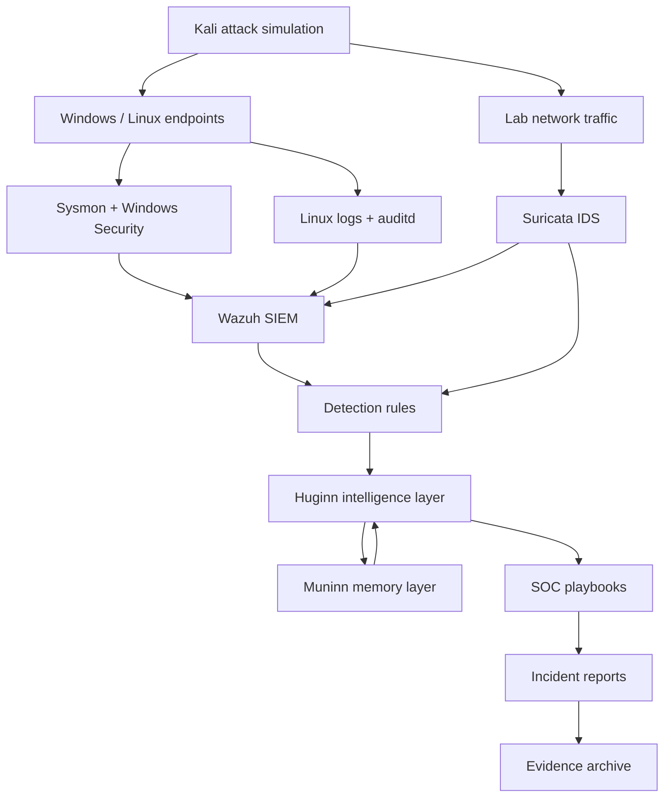
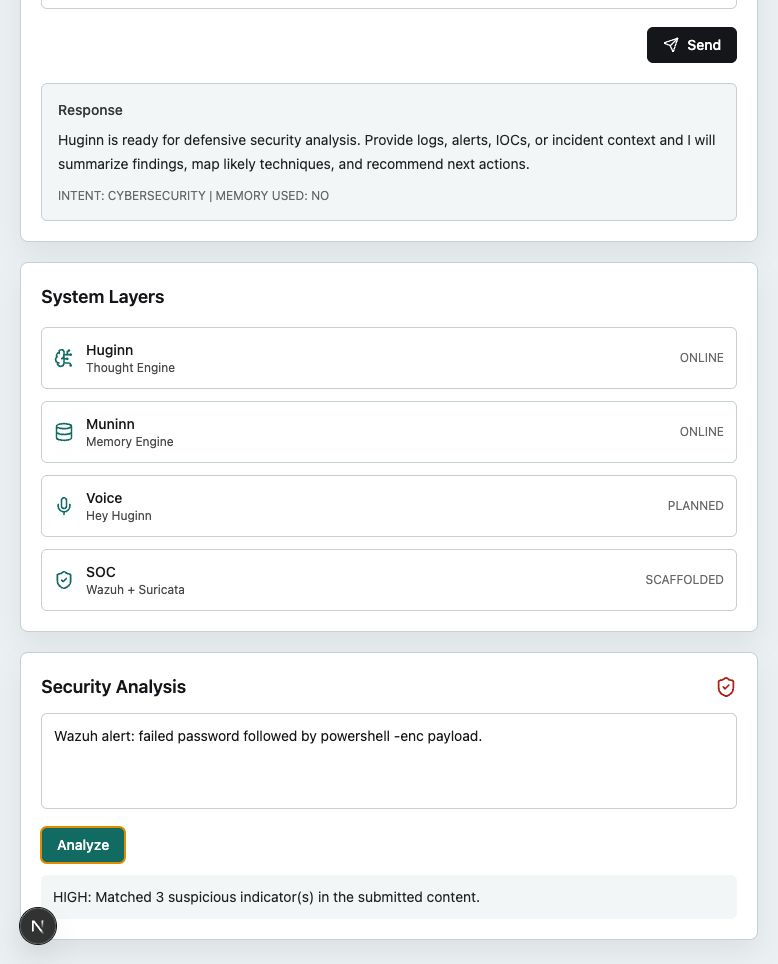
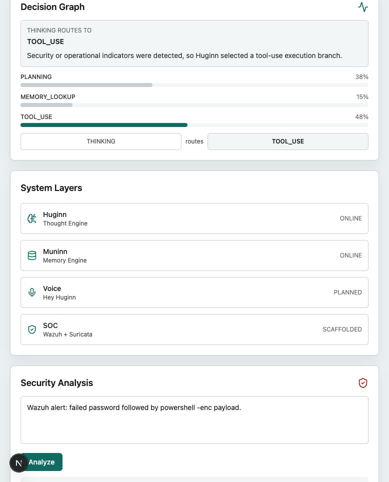
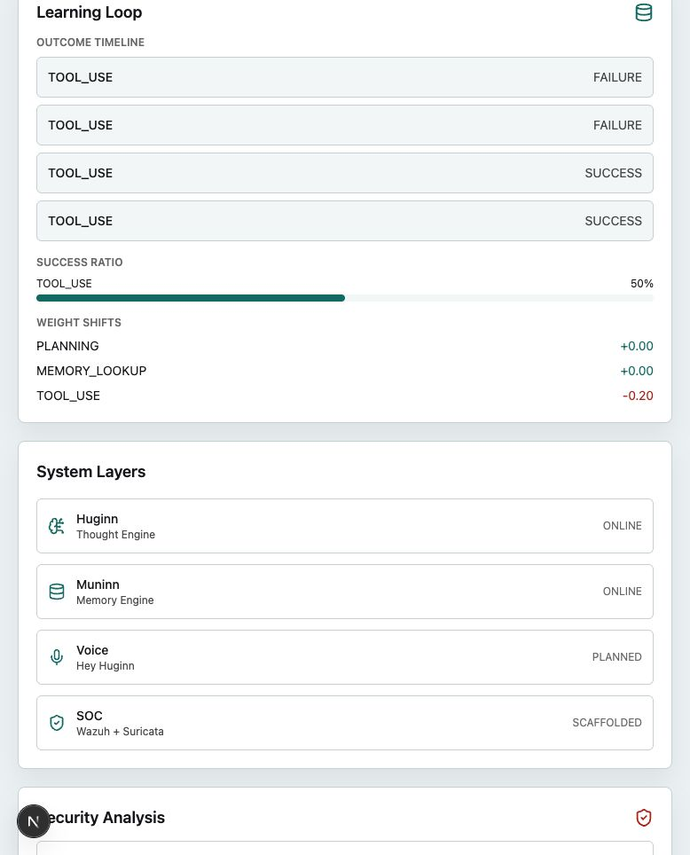
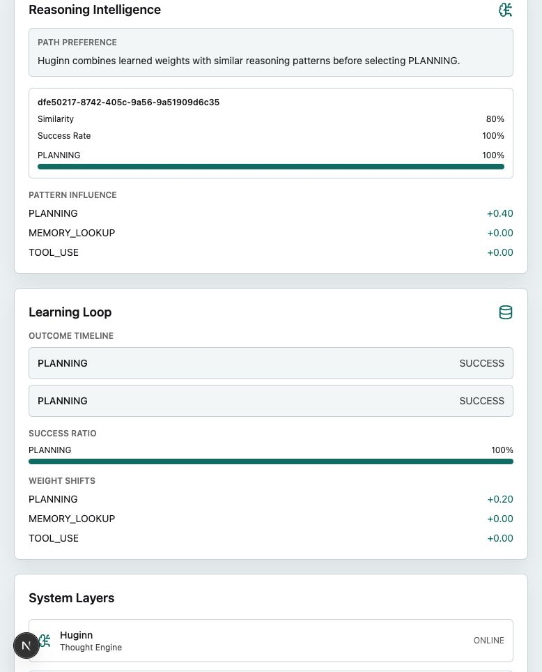

# HUGINN // MUNINN SOC Home Lab

HUGINN // MUNINN is a private SOC detection engineering home lab and AI-assisted analysis platform.

The repository is structured to demonstrate Tier 1 to Tier 2 SOC analyst capability:

- telemetry collection with Wazuh, Sysmon, Suricata, Linux logging, and auditd
- controlled attack simulation with Kali Linux
- detection rules mapped to MITRE ATT&CK
- analyst playbooks and incident reports
- evidence-driven lab documentation
- Huginn intelligence orchestration
- Muninn memory, recurrence, and reasoning-pattern storage

## Architecture



## Huginn and Muninn

Huginn is the intelligence layer. It handles event orchestration, context signatures, graph-based decision routing, reasoning pattern matching, and outcome learning.

Muninn is the memory layer. It stores execution history, outcomes, recurring behavior, learned weights, and reasoning patterns that influence future analysis.

Together they support this workflow:

```text
attack simulation
  -> telemetry collection
  -> detection rule trigger
  -> canonical SOC event bus
  -> detection-to-playbook routing
  -> analyst triage
  -> SOC health metrics and gap analysis
  -> Huginn reasoning
  -> Muninn memory update
  -> incident report
  -> detection tuning
```

## Repository Layout

```text
core/                 Huginn/Muninn architecture notes
labs/                 SOC lab scenarios
detection-engine/     Wazuh, Suricata, Sysmon, and auditd detection content
playbooks/            Analyst triage and response procedures
reports/              Incident report workspace
evidence/             Sanitized lab evidence workspace
templates/            Reusable lab, report, and detection templates
scripts/              Validation utilities
apps/                 Huginn/Muninn API and dashboard
docs/                 Architecture, repository tree, screenshots, checklist
```

See [docs/repository-tree.md](docs/repository-tree.md) for the full repository tree.
See [docs/event-flow.md](docs/event-flow.md) for the SOC event pipeline.

Core analytics now include SOC health metrics and gap findings. These modules consume canonical event bus history and write suggestion-only memory artifacts; they do not modify detection rules automatically.

## Detection Engineering Standards

Every detection should include:

- consistent rule name: `SOC-<SOURCE>-<BEHAVIOR>-<NUMBER>`
- MITRE ATT&CK tactic and technique ID
- telemetry source
- test procedure
- expected result
- false-positive notes
- tuning notes

Current rule examples:

- Wazuh: `SOC-WIN-AUTH-BRUTEFORCE-001`
- Suricata: `SOC-NET-SMB-PROBE-001`

## Labs

Current lab:

- [Lab 001: Windows Authentication Brute Force](labs/001-windows-auth-bruteforce/README.md)

Each lab README follows this structure:

- Objective
- Attack scenario
- MITRE ATT&CK mapping
- Setup steps
- Attack execution steps
- Detection rules: Wazuh and Suricata
- Evidence section
- Incident report: timeline, impact, response, lessons learned

## Templates

- [Lab README template](templates/lab-readme-template.md)
- [Incident report template](templates/incident-report-template.md)
- [Detection rule template](templates/detection-rule-template.md)

## Screenshots

### Dashboard



### Decision Graph



### Learning Loop



### Reasoning Patterns



## Development Setup

### Requirements

- Python 3.11+
- Node.js 20+
- npm
- Docker, optional for PostgreSQL and ChromaDB
- Wazuh, Sysmon, Suricata, auditd, and Kali for full lab execution

### Backend

```bash
cd apps/api
python -m venv .venv
. .venv/bin/activate
pip install -e ".[dev]"
uvicorn --app-dir src huginn_muninn_api.main:app --reload
```

### Frontend

```bash
cd apps/web
npm install
npm run dev
```

### Infrastructure

```bash
docker compose up postgres chroma
```

Default local URLs:

- Dashboard: `http://127.0.0.1:3000`
- API: `http://127.0.0.1:8000`
- ChromaDB via Compose: `http://127.0.0.1:8001`

## Validation

Run backend tests:

```bash
apps/api/.venv/bin/python -m pytest apps/api/tests
```

Run backend linting:

```bash
apps/api/.venv/bin/ruff check apps/api/src apps/api/tests
```

Build frontend:

```bash
cd apps/web
npm run build
```

Validate Wazuh XML rules:

```bash
python scripts/validate_wazuh_rules.py
```

## Roadmap

### Phase 1: SOC Detection Portfolio

- Lab structure
- Detection rule standards
- Incident report templates
- Evidence handling

### Phase 2: Detection Engineering Expansion

- Additional Windows, Linux, and network labs
- Wazuh rule packs
- Suricata rule packs
- Sysmon event correlation
- auditd detections

### Phase 3: AI-Assisted SOC Analysis

- Huginn event orchestration
- Muninn memory-driven recurrence tracking
- Reasoning pattern extraction
- Analyst dashboard

### Phase 4: Automated Lab Generation

- Generate lab scaffolds from a scenario name
- Generate rule templates
- Generate incident report drafts
- Validate MITRE mappings

## Security Notes

This repository is for defensive, authorized lab work only. Do not use it for unauthorized scanning, exploitation, credential harvesting, or intrusion.

Do not commit `.env`, API keys, credentials, unsanitized packet captures, private logs, local runtime memory, virtual environments, dependency folders, build outputs, or generated caches.

## License

MIT. See [LICENSE](LICENSE).
