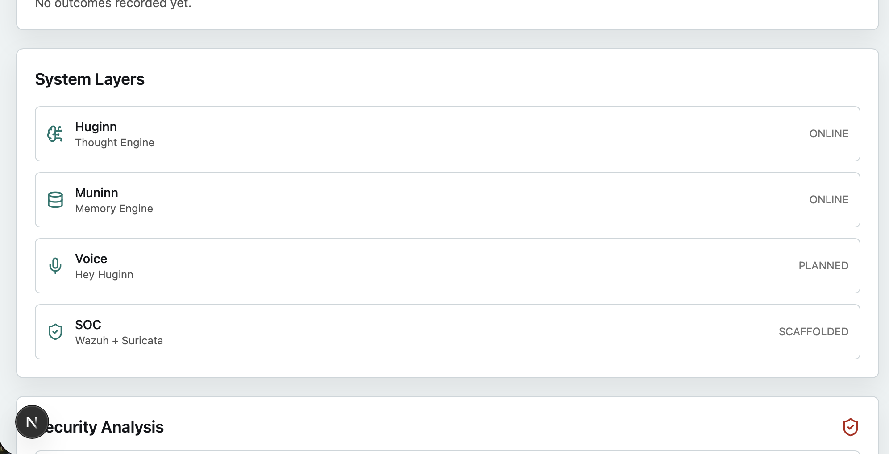
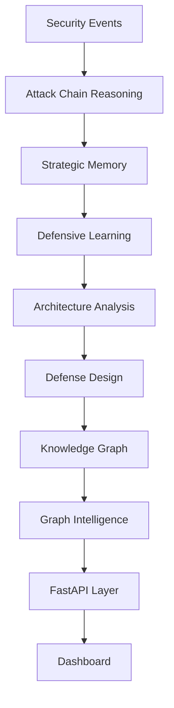
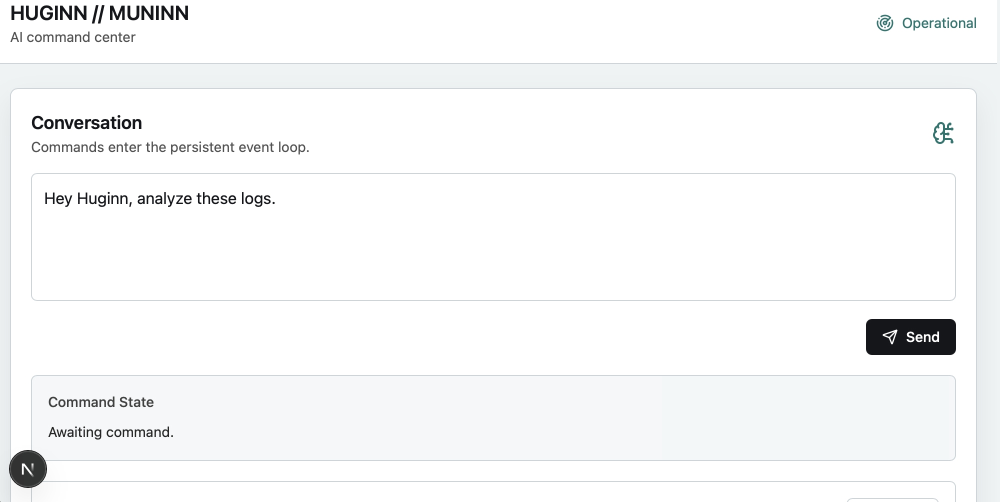
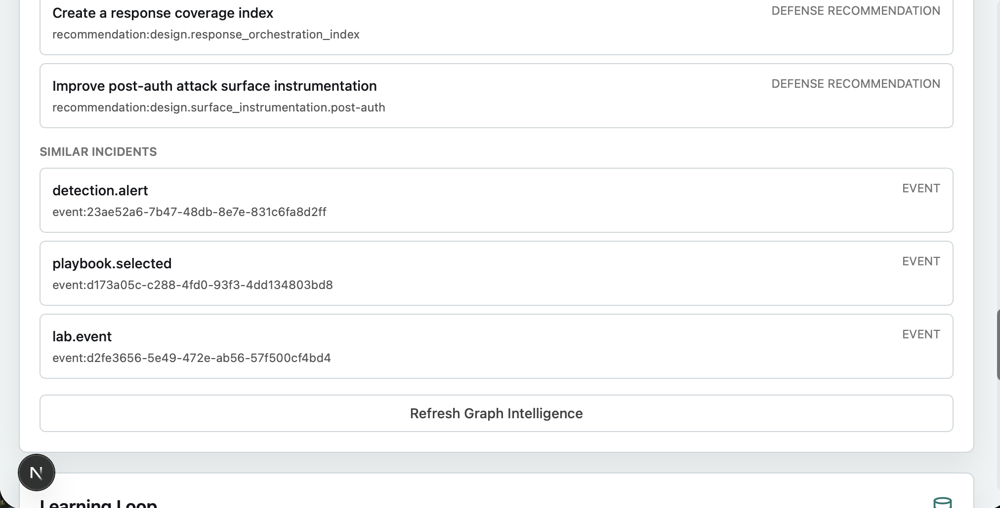

# HUGINN // MUNINN

## AI-Powered Defensive Intelligence Platform

A graph-driven cybersecurity platform designed to help analysts connect events, understand attack paths, retain context, and generate explainable defensive recommendations.

Huginn // Muninn is an early-stage defensive intelligence system for security analysis, threat correlation, memory-driven learning, and evidence-backed decision support. The platform is designed to transform isolated security observations into connected operational context that can support investigations, reporting, and future AI-assisted SOC workflows.

## Architecture Overview



Huginn and Muninn are modeled after Odin's ravens. Huginn represents thought and reasoning. Muninn represents memory and historical context. Together they provide structured defensive intelligence built on top of a knowledge graph.

The current architecture connects event analysis, attack-chain reasoning, defensive learning, evidence generation, graph intelligence, API access, and dashboard visibility.



## Dashboard



The dashboard acts as the command center for the platform. It provides:

- Conversation interface
- Event processing
- Security analysis
- Graph intelligence visibility
- System state monitoring

## Graph Intelligence



The Graph Intelligence layer transforms isolated security events into connected context. It identifies:

- Related entities
- Similar incidents
- Defensive recommendations
- Architectural weaknesses
- Attack chain relationships

This gives Huginn a structured way to ask questions such as what a security event is connected to, which weaknesses are related to a technique, and what recommendations are supported by known context.

## Graph Intelligence API

.png)

The FastAPI layer exposes graph intelligence data for dashboards, automation workflows, and future AI reasoning components.

Current graph statistics:

- 43 Nodes
- 42 Relationships
- MITRE ATT&CK mappings
- Attack chain relationships
- Memory links
- Defensive recommendations

Current read-only API endpoints:

```text
GET /graph/summary
GET /graph/related/{entity_id}
GET /graph/weaknesses/{entity_id}
GET /graph/recommendations/{technique_id}
GET /graph/similar-incidents/{event_id}
```

## Core Capabilities

Huginn // Muninn currently supports several defensive intelligence capabilities:

- Event-driven security analysis for structured SOC context
- Attack-chain reconstruction using MITRE ATT&CK techniques
- Memory-driven learning from reports, outcomes, and recurring patterns
- Knowledge graph modeling for events, techniques, weaknesses, recommendations, and memory entries
- Graph intelligence queries for related entities, connected weaknesses, similar incidents, and recommendations
- Evidence data modeling and evidence builder output for explainable findings
- Architecture-level defense analysis and recommendation generation
- Dashboard and API visibility for the current intelligence layer

## Current Features

| Feature | Status |
|----------|----------|
| Knowledge Graph | ✅ |
| Graph Intelligence | ✅ |
| FastAPI API | ✅ |
| Dashboard | ✅ |
| Evidence Layer Phase 1 | ✅ |
| Evidence Builder Phase 2 | ✅ |
| Huginn Thought Engine | ✅ |
| Muninn Memory Engine | ✅ |
| Voice Layer | 🚧 |
| SOC Integration | 🚧 |

## Current Platform Status

| Area | Current State |
| --- | --- |
| Huginn | Online |
| Muninn | Online |
| Knowledge Graph | Active |
| Graph Intelligence | Active |
| Evidence Layer | Phase 1 and Phase 2 complete |
| API | Operational |
| Dashboard | Operational |
| Graph Size | 43 nodes, 42 relationships |
| Focused Validation | 26 tests passing |

## Validation

Current validation status:

- Graph/API/Evidence tests passing
- 26 tests passing
- API operational
- Dashboard operational
- Graph intelligence operational

Focused test command:

```bash
PYTEST_DISABLE_PLUGIN_AUTOLOAD=1 apps/api/.venv/bin/python -m pytest apps/api/tests/test_knowledge_graph.py apps/api/tests/test_graph_intelligence.py apps/api/tests/test_graph_api.py apps/api/tests/test_evidence_schema.py apps/api/tests/test_evidence_builder.py -q
```

## Project Vision

Huginn // Muninn is not intended to replace analysts. The goal is to augment analyst decision making by:

- Connecting fragmented information
- Preserving institutional memory
- Explaining defensive recommendations
- Providing evidence-backed reasoning
- Accelerating threat investigation workflows

The long-term direction is an AI-assisted defensive operations platform where security events, prior incidents, architecture weaknesses, and analyst knowledge are connected into a persistent reasoning system.

## Roadmap

### Phase 1

- Knowledge Graph
- Graph Intelligence
- Dashboard

### Phase 2

- Evidence Layer
- Evidence Builder

### Phase 3

- Evidence Query Engine
- Evidence API
- Evidence Dashboard

### Phase 4

- Voice Layer
- Hey Huginn

### Phase 5

- Wazuh Integration
- Suricata Integration
- Real SOC Event Ingestion

### Phase 6

- Autonomous Investigation Assistant

## Why This Project Exists

Security teams often have enough data but not enough connected context. Alerts, incidents, architecture notes, recommendations, and historical lessons are frequently stored in separate places. That makes it harder to understand what happened, why it matters, what has been seen before, and which defensive action should come next.

Huginn // Muninn addresses that gap by modeling defensive knowledge as connected intelligence instead of isolated records.

## Skills Demonstrated

This project demonstrates practical cybersecurity engineering and platform design skills:

- SOC detection engineering concepts
- MITRE ATT&CK-aligned analysis
- Attack-chain reasoning
- Defensive architecture analysis
- Knowledge graph design
- Evidence and confidence modeling
- FastAPI service design
- Dashboard integration
- Testable Python module development
- Security-focused documentation and roadmap planning

## Development

Start the API:

```bash
cd apps/api
PYTHONPATH=src .venv/bin/uvicorn huginn_muninn_api.main:app --reload --host 127.0.0.1 --port 8000
```

Start the dashboard:

```bash
cd apps/web
npm run dev
```

Open:

```text
http://127.0.0.1:3000
```
