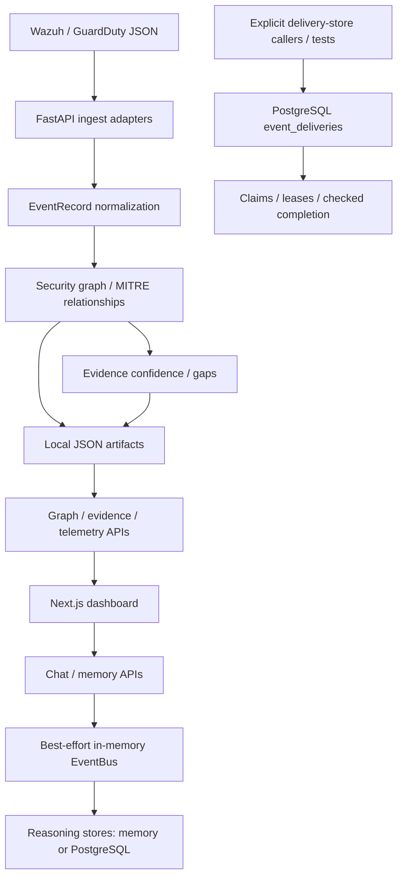

# HUGINN // MUNINN

A defensive intelligence platform that organizes security telemetry, connects events to MITRE ATT&CK, records evidence and uncertainty, and provides an investigation dashboard. Built as a cybersecurity portfolio and engineering project for synthetic labs and controlled local testing, not production security operations.

   


## How It Works

Security alerts from Wazuh (endpoint) or AWS GuardDuty (cloud) are sent to the FastAPI backend via a `POST` request. The backend normalizes each alert into a common `EventRecord` format, adds it to a JSON-backed Security Knowledge Graph connected to MITRE ATT&CK techniques, and persists an evidence record with a confidence score before acknowledging ingestion. If a required piece of context is missing — such as a MITRE mapping or a defensive recommendation — the system records that gap explicitly rather than ignoring it. The Next.js dashboard polls the backend every 10–30 seconds and displays the current telemetry, severity breakdown, evidence counts, and any open gaps.

**Huginn** is the thought engine — it routes incoming requests, classifies intent, and coordinates the analysis pipeline.  
**Muninn** is the memory engine — it stores event history, reasoning patterns, and outcome records across the session.

## Engineering Status

The verified foundation includes restart-persistent security artifacts, synchronized repository module loading, a failure-contained in-memory event worker, and a separate PostgreSQL delivery store with durable admission, scoped idempotency, atomic claims, and explicit expired-lease recovery.

**The delivery store is not connected to production routes or workflow handlers.** Storage recovery does not imply automatic processing. See [architecture](docs/architecture.md), [persistence and recovery](docs/MUNINN_PERSISTENCE.md), and [milestone history](CHANGELOG.md).

Use the manual quick start below for controlled testing. The existing `demo.sh` convenience script installs dependencies, starts services, and writes a synthetic alert to repository artifacts; it is not a read-only validation tool. Use a disposable checkout for write demonstrations.

## What Is Real vs. Synthetic

| Item | Status |
| --- | --- |
| FastAPI backend with 26 endpoints | Real — runs locally |
| Wazuh alert normalization pipeline | Real — parses alert JSON into `EventRecord` |
| AWS GuardDuty normalization parser | Real — same normalization path |
| JSON-backed Security Knowledge Graph | Real graph structure, seeded with **synthetic sample data**, plus persisted runtime alerts |
| MITRE ATT&CK technique mappings (T1078, T1087, T1110, T1046) | Real technique IDs, connected to **synthetic lab events** |
| Evidence records and confidence scores | Real scoring logic, applied to **synthetic events** |
| Evidence gap detection | Real — gaps are recorded when MITRE mapping or recommendation is missing |
| Live telemetry dashboard (10s/30s refresh) | Real polling, reading from local report files |
| Security events in the dashboard | Mix of synthetic pipeline events and the injected demo alert |
| `POST /ingest/wazuh` and `POST /ingest/guardduty` | Real endpoints — merge graph and evidence into local JSON storage |
| Wazuh detection rules in `detection-engine/` | Real rule syntax, written for a lab environment — not deployed to a live Wazuh instance |
| Raw Wazuh alert log files | **Not included** — no real host logs are committed to this repository |

## Dashboard Panels


The dashboard is a single-page Next.js application with the following panels, all populated from the running API:

- **Live Telemetry Intelligence** — severity breakdown, recent security events, top rule IDs, top agents, evidence summary, and evidence gaps
- **Graph Intelligence** — knowledge graph summary (total nodes and relationships), top connected entities, MITRE technique connections, architecture weaknesses, and defensive recommendations
- **Evidence** — full evidence index with confidence levels
- **Conversation** — command input routed through the Huginn engine (rule-based intent classification, no language model)
- **Decision Graph / Reasoning Intelligence** — records of path decisions and reasoning patterns from the current session
- **Learning Loop** — outcome records written during the session
- **System Layers** — live status of each subsystem (Huginn, Muninn, Voice, SOC)
- **Security Analysis** — keyword-based log scanner that maps suspicious terms to MITRE tactics


## Current Limitations

- Runtime Wazuh/GuardDuty ingestion persists the Security Knowledge Graph to `reports/knowledge-graph.json` and evidence to `reports/evidence-index.json`; graph counts are published to `core/patterns/knowledge-graph-summary.json`. API restarts preserve these files. Keep these directories on writable, persistent local storage (including when running in containers). Deleting the checkout, replacing it with a fresh deployment, or regenerating sample artifacts can erase runtime data.
- JSON storage uses a shared macOS/Linux file lock around ingestion and atomic, fsynced file replacements. It rewrites whole artifacts and is intended for a local demo, not distributed/high-volume ingestion. Graph, summary, and evidence are separate writes, not a multi-file transaction: interrupted or failed requests may partially persist and should be retried with the same alert IDs. Accepted requests need no shutdown flush. The telemetry report shows the latest batch, not the complete persisted history.
- Standalone `KnowledgeGraph()` instances remain in-memory until explicitly saved. Runtime ingestion uses JSON regardless of Muninn's `persistence_backend` setting; evidence queries prefer the persisted index over stale generated records with the same ID.
- Muninn's reasoning memory (chat memory records, outcome history, learned path weights, reasoning patterns, and the full system event log) can optionally persist to PostgreSQL across restarts. The default remains in-memory. Review database identity, credentials, port bindings, and startup schema changes before enabling `PERSISTENCE_BACKEND=postgres`; see [docs/MUNINN_PERSISTENCE.md](docs/MUNINN_PERSISTENCE.md).
- Intelligence is rule-based and graph-based. There is no machine learning, no language model, and no external AI API call anywhere in the running code.
- The Conversation panel accepts text input but responds with template strings, not generated analysis.
- Wazuh and GuardDuty ingestion accepts JSON payloads directly. There is no live connection to a running Wazuh instance or AWS account.
- The SOC layer (Wazuh + Suricata) is scaffolded — the detection rules exist, but the full pipeline to a live sensor is not wired.
- No authentication or access control has been implemented.
- ChromaDB in `docker-compose.yml` remains unused by the current application — it is a placeholder for future vector-search work, out of scope for this milestone.
- EventBus acceptance is best-effort and in-memory even when its event log uses PostgreSQL. A crash can lose queued events. Individual failures are counted, not retried automatically.
- The separate delivery store has no automatic durable dispatch, complete retry execution policy, dead-letter handling, lease renewal, or complete handler-side-effect deduplication. End-to-end delivery guarantees and exactly-once external execution have not been demonstrated.
- Docker uses development credentials and host port bindings that require hardening. Existing ingestion endpoints may expose raw exception details. Keep services on loopback; production deployment has not been approved.

## What I Learned

- How to design a normalization layer (`EventRecord`) so that multiple detection sources — Wazuh, GuardDuty — can share a single downstream pipeline without requiring changes to the graph or evidence logic
- How MITRE ATT&CK technique IDs connect to real detection patterns, and why gap detection (tracking what you *cannot* confirm) matters as much as what you can
- How to build a knowledge graph from scratch without a graph database — using in-memory nodes, relationships, and traversal queries backed by JSON
- How to structure a FastAPI application with a clean separation between ingestion, intelligence, and telemetry layers, each independently testable
- How to wire a Next.js frontend to a live backend using polling intervals, stable `useCallback` dependencies, and graceful stale-data fallbacks
- How to write tests that exercise real behavior rather than mocking away the logic being tested, including a persistence "restart test" that proves state survives independent process/store creation rather than asserting a row exists in a table

## Architecture



The three persistence paths are separate: security graph/evidence JSON, optional reasoning-store PostgreSQL, and opt-in delivery storage. Adding a source can reuse `EventRecord`, but its mappings, evidence semantics, and dashboard compatibility still require validation.

## API Reference

| Endpoint | Description |
| --- | --- |
| `POST /ingest/wazuh` | Accept Wazuh alert payload |
| `POST /ingest/guardduty` | Accept GuardDuty finding payload |
| `GET /dashboard/summary` | Telemetry summary |
| `GET /dashboard/events` | Recent security events |
| `GET /dashboard/evidence` | Evidence summary |
| `GET /dashboard/last-updated` | Cache and reload status |
| `GET /graph/summary` | Knowledge graph summary |
| `GET /graph/related/{entity_id}` | Related graph entities |
| `GET /graph/weaknesses/{entity_id}` | Connected architecture weaknesses |
| `GET /graph/recommendations/{technique_id}` | Defensive recommendations for a technique |
| `GET /evidence/mitre/{technique_id}` | Evidence for a MITRE technique |
| `GET /evidence/summary` | Full evidence index |

## Quick Start

**Validated environment:** Python 3.11.15, Node.js 22.23.1, npm 10.9.8; macOS local storage. Python declares `>=3.11`; other versions are not covered by this baseline. JSON file locking supports macOS/Linux, not native Windows. Python dependencies use ranges without a lockfile; frontend versions are locked by `package-lock.json`.

Start each terminal at the repository root. Ensure ports 8000 and 3000 are free. The default demo needs neither Docker nor PostgreSQL. Do not use real investigation data in this unauthenticated local setup.

### Backend

```bash
cd apps/api
python3.11 -m venv .venv
.venv/bin/python -m pip install -e ".[dev]"
PYTHONDONTWRITEBYTECODE=1 PYTHONPATH=src PERSISTENCE_BACKEND=memory \
  .venv/bin/python -m uvicorn huginn_muninn_api.main:app \
  --host 127.0.0.1 --port 8000 --workers 1
```

In another terminal, `curl -f http://127.0.0.1:8000/health` should report an available event worker. This is application health, not database readiness.

### Dashboard

> **Mac (Homebrew) only:** if Node 22 is not your default, run this first:
> `export PATH="/opt/homebrew/opt/node@22/bin:$PATH"`
>
> On other supported local environments, use Node 22 and skip this step.

```bash
cd apps/web
npm ci
NEXT_PUBLIC_API_URL=http://127.0.0.1:8000 npm run dev
```

Open `http://localhost:3000`.

For production-build validation, from `apps/web` run `npm run lint`, then `NEXT_PUBLIC_API_URL=http://127.0.0.1:8000 npm run build`. The build performs TypeScript validation. To serve that build locally, use `npm run start -- --hostname 127.0.0.1 --port 3000` instead of the dev server. Public API URL settings are embedded at build time. Stop servers with Ctrl+C in their own terminals.

### Ingest a test alert

**This writes graph, evidence, summary, and pipeline JSON in the checkout.** Use a disposable copy, not a protected baseline. Historical synthetic timestamps are not live detections. Inspect the graph/evidence panels before and after submission; their totals cover different scopes from the latest-batch telemetry panel.

```bash
curl -X POST http://localhost:8000/ingest/wazuh \
  -H "Content-Type: application/json" \
  -d '{
    "id": "demo-0001",
    "timestamp": "2026-06-17T15:00:00.000Z",
    "agent": { "name": "demo-endpoint-01" },
    "rule": {
      "id": "DEMO-60122",
      "level": 10,
      "description": "Synthetic repeated authentication failure pattern",
      "mitre": { "id": ["T1110", "T1078"] }
    }
  }'
```

The dashboard will reflect the ingestion within 30 seconds. Reusing an already ingested alert ID returns `events_added: 0`; graph entities and evidence IDs are deduplicated across restarts.

### Verify persistence across an API restart

After posting the Wazuh alert above, optionally add a synthetic GuardDuty finding:

```bash
curl -f -X POST http://localhost:8000/ingest/guardduty \
  -H 'Content-Type: application/json' \
  -d '{"id":"demo-guardduty-0001","type":"Trojan:EC2/BlackholeTraffic","severity":8,"createdAt":"2026-06-17T15:00:00Z"}'
```

Stop and restart the API with the same checkout and files, using the backend command above. If using `./demo.sh`, stop with Ctrl+C and rerun it; its repeated `demo-0001` injection should add zero events. Do not regenerate the sample graph or evidence index between runs.

```bash
curl -f http://localhost:8000/graph/related/event:demo-0001
curl -f http://localhost:8000/evidence/finding/event:demo-0001
curl -f http://localhost:8000/graph/related/event:demo-guardduty-0001
curl -f http://localhost:8000/evidence/finding/event:demo-guardduty-0001
```

Expect connected MITRE techniques and one event evidence record per finding both before and after restart. Repost either payload to verify deduplication. No Postgres setup is required for this check.

## Testing

### Recorded validation baseline

Phase 2 technical validation on 2026-10-27 covered the exact implementation later committed as `9371666`. These are recorded results, not tests rerun during this documentation phase.

| Check | Recorded result |
| --- | --- |
| Backend discovery | 278 tests |
| Backend with separate isolated PostgreSQL databases | 274 passed, 0 failed, 0 skipped, 4 deselected |
| Artifact-writing tests in a temporary repository copy | 4 passed |
| Focused delivery tests (subset of the above) | 41 passed |
| Worker-crash recovery diagnostic | Passed: abrupt process exit, real lease expiry, competing recovery, stale-token rejection |
| Ruff / frontend ESLint / TypeScript / Next.js production build | Passed |

All 278 discovered backend tests passed **across isolated runs, not in one combined invocation**. The crash diagnostic was temporary validation code, not a committed test. Backend validation reported a Starlette/AnyIO deprecation warning; `next lint` reported its planned removal in Next.js 16.

### Safe default regression run

From the repository root, with dependencies already installed:

```bash
cd apps/api
env -u TEST_DATABASE_URL -u HM_DELIVERY_TEST_DSN \
  PYTHONDONTWRITEBYTECODE=1 PYTHONPATH=src \
  .venv/bin/python -B -m pytest tests/ -p no:cacheprovider -q -rs \
  --deselect=tests/test_evidence_query.py::test_committed_sample_evidence_query_output_loads \
  --deselect=tests/test_graph_ingest.py::test_committed_sample_graph_ingest_output_loads \
  --deselect=tests/test_real_data_evidence.py::test_committed_real_data_evidence_output_loads \
  --deselect=tests/test_wazuh_pipeline.py::test_committed_sample_wazuh_pipeline_output_loads
```

This selection previously produced 253 passed, 21 skipped, 4 deselected without PostgreSQL. Existing pytest configuration disables the AnyIO plugin. The four excluded tests regenerate committed reports; run them only in a temporary copy containing source, fixtures, and reports. Disabling bytecode and pytest caches alone does not prevent those artifact writes.

See [isolated PostgreSQL test instructions](docs/MUNINN_PERSISTENCE.md#isolated-postgresql-tests). Never point tests at a development or production database: some legacy fixtures delete rows. Tests cover EventBus reliability, Wazuh/GuardDuty ingestion, graph/evidence queries, restart persistence, and durable-delivery storage.

## Tech Stack

| Layer | Technology |
| --- | --- |
| Backend | Python 3.11, FastAPI, asyncio |
| Parsing | Custom `EventRecord` normalization layer |
| Graph | JSON-backed runtime knowledge graph with relationship traversal; standalone instances remain in-memory |
| Evidence | Custom confidence scoring and gap detection engine |
| Frontend | Next.js 15, TypeScript, Tailwind CSS |
| Testing | pytest; 278 discovered tests passed across isolated validation runs |
| Persistence | Local JSON security artifacts; optional PostgreSQL reasoning stores; separate PostgreSQL admission/lease foundation |
| Telemetry sources | Wazuh (endpoint), AWS GuardDuty (cloud) |
| MITRE | ATT&CK technique mapping, graph-connected |

## Project Status

- [x] Knowledge graph with MITRE ATT&CK mapping
- [x] Evidence layer with confidence scoring and gap detection
- [x] Wazuh alert normalization pipeline
- [x] AWS GuardDuty normalization parser
- [x] Runtime ingestion via `POST /ingest/wazuh` and `POST /ingest/guardduty`
- [x] Near-live telemetry dashboard (10s/30s polling)
- [x] Graph intelligence queries (related entities, weaknesses, recommendations)
- [x] Evidence gap detection as first-class findings
- [x] One-command demo script
- [x] Muninn reasoning-memory persistence (opt-in Postgres backend for memory, outcomes, learned weights, reasoning patterns, event log — see [docs/MUNINN_PERSISTENCE.md](docs/MUNINN_PERSISTENCE.md))
- [x] Persistent Security Knowledge Graph and evidence index (local JSON, independent of Muninn reasoning memory)
- [x] Shared module-loader synchronization and bounded EventBus failure/shutdown handling
- [x] PostgreSQL durable admission, scoped idempotency, atomic claims, explicit lease recovery
- [ ] Durable dispatcher and handler integration with side-effect idempotency
- [ ] Lease renewal, bounded retry execution, and dead-letter policy
- [ ] Authentication, least-privilege deployment, and sanitized ingestion errors
- [ ] Live Wazuh API connection (planned)
- [ ] Voice interface — Hey Huginn (planned)

See [docs/DEMO_SCRIPT.md](docs/DEMO_SCRIPT.md) for the full demo walkthrough.

## Notes

- Raw Wazuh alert log files are not committed to this repository.
- All test fixtures and graph seed data use synthetic data only.
- `docker-compose.yml` provisions Postgres (now used, opt-in, by Muninn's persistence layer — see [docs/MUNINN_PERSISTENCE.md](docs/MUNINN_PERSISTENCE.md)) and ChromaDB (still unused, placeholder for future vector-search work). Neither is required to run the demo — Muninn defaults to in-memory, while runtime security graph/evidence use local JSON.
- This project is a cybersecurity portfolio and learning exercise. It is not production-ready and has no authentication.
- [Architecture](docs/architecture.md) distinguishes implemented components from planned capabilities.

## License

[MIT](LICENSE)
