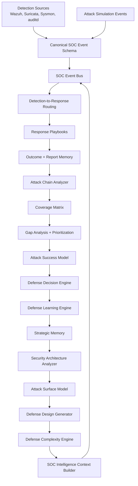

# HUGINN // MUNINN

## Overview

HUGINN // MUNINN is an evolving defensive intelligence platform for event-driven security analysis, attack-chain reasoning, memory-driven learning, and architecture-level defense design.

The project is built around a central idea: defensive systems should not stop at alerting. They should preserve context, reconstruct adversary progression, identify recurring defensive weaknesses, measure whether coverage is improving, and recommend architectural changes that make future attacks harder to complete.

Huginn represents the intelligence and reasoning layer. It processes security events, models attack paths, prioritizes gaps, estimates attack success probability, and generates defensive recommendations.

Muninn represents the memory layer. It stores outcomes, recurring weaknesses, strategic patterns, learning insights, and historical posture metrics so future decisions are influenced by what the system has already observed.

The long-term vision is an AI-assisted defensive operations platform that can help SOC teams move from isolated alert handling toward adaptive, evidence-driven defense improvement.

## Core Architecture



The system is organized into clear responsibility boundaries:

- `detection-engine/`: sensor definitions and detection content for Wazuh, Suricata, Sysmon, and auditd.
- `core/`: event normalization, intelligence routing, analytics, learning, architectural reasoning, and recommendation engines.
- `playbooks/`: response procedures selected by the routing layer.
- `reports/`: generated intelligence outputs, outcome records, posture snapshots, and decision artifacts.
- `core/patterns/`: long-term strategic memory and recommendation-only learning artifacts.
- `apps/api/`: FastAPI backend for Huginn/Muninn orchestration, event handling, decision routing, memory, and reasoning patterns.
- `apps/web/`: Next.js dashboard surface for event, decision, outcome, and reasoning visibility.
- `docs/`: architecture documentation, event-flow documentation, repository tree, screenshots, and publication notes.

## Intelligence Layers

### Detection Layer

The detection layer represents raw defensive sensor coverage. Current repository content includes Wazuh and Suricata rule examples, Sysmon documentation, auditd guidance, and MITRE ATT&CK-aligned detection conventions.

This layer is intentionally treated as sensor-only. Higher-level intelligence modules consume normalized events and reports rather than directly modifying detection rules.

### Correlation Layer

The correlation layer converts individual events into structured security context. It includes:

- canonical SOC event schema
- in-memory SOC event bus
- detection-to-playbook mapping
- attack-chain reconstruction
- MITRE technique sequencing
- missing transition detection
- coverage matrix generation

This moves the system beyond isolated alert handling and toward chain-aware defensive reasoning.

### Learning Layer

The learning layer evaluates whether defensive actions are working over time. It includes:

- outcome tracking
- SOC health metrics
- false-positive indicators
- playbook success measurement
- defense evolution tracking
- recurring weakness extraction
- gap closure rate analysis

Learning outputs are recommendation-only. The system records what should be improved, but does not automatically rewrite detection logic.

### Memory Layer

Muninn stores the system's accumulated defensive memory. It captures:

- detection outcomes
- pattern suggestions
- prioritized gaps
- strategic memory patterns
- learning insights
- architecture weaknesses
- evolution snapshots

This memory is used by the context builder so future reasoning can account for repeated failures, structural blind spots, and previous defensive decisions.

### Architecture Analysis Layer

The architecture analysis layer identifies system-level blind spots rather than rule-level issues. Implemented modules analyze:

- recurring post-auth weaknesses
- missing chain transitions
- weak response orchestration
- telemetry blind spots
- under-instrumented attack surface layers
- complexity versus coverage tradeoffs

The current analysis identifies post-auth activity as a critical under-instrumented layer, especially around valid account use and account discovery.

### Defensive Design Layer

The defensive design layer converts architecture weaknesses into system design recommendations. It focuses on:

- new defensive subsystems
- telemetry enrichment layers
- attack-chain correlation services
- response coverage indexing
- attack surface instrumentation maps
- simplification opportunities when architecture grows faster than coverage

It does not generate detection rules. Its purpose is to guide defensive architecture evolution.

## Current Capabilities

Implemented functionality includes:

- Canonical SOC event model with event type, source system, MITRE mapping, severity, timestamp, raw payload, and normalized context.
- In-memory SOC event bus with event persistence to `reports/soc-events.jsonl`.
- Detection alert ingestion and lab event ingestion.
- Detection-to-playbook routing for brute force and SMB probing scenarios.
- Outcome tracking with analyst notes and tuning suggestions.
- SOC health reporting with coverage, false-positive indicators, playbook success rate, and mean detection-to-response time.
- Gap analysis for missed techniques, weak detection coverage, and outcome quality concerns.
- Attack chain reconstruction across MITRE techniques and defensive phases.
- Coverage matrix mapping techniques to detection status, chain correlation, and response effectiveness.
- Prioritized gap ranking based on chain severity, exploitability, and exposure risk.
- Attack success probability modeling.
- Defensive action planning and improvement prioritization.
- Defensive learning insights based on recurring weaknesses and structural failures.
- Evolution metrics for coverage, risk, open gaps, critical gaps, and gap closure rate.
- Strategic memory for repeated attack and failure combinations.
- Security architecture weakness analysis.
- Attack surface modeling across pre-auth, auth, and post-auth layers.
- Defensive design recommendation generation.
- Defense complexity analysis for simplification opportunities.
- FastAPI backend with event-driven orchestration, graph-based decision routing, outcome tracking, and reasoning pattern support.
- Next.js dashboard for visualizing events, decisions, outcomes, learning, and reasoning patterns.

Generated intelligence artifacts currently include:

- `reports/attack-chain-analysis.json`
- `reports/coverage-matrix.json`
- `reports/prioritized-gaps.json`
- `reports/attack-success-probability.json`
- `reports/defense-plan.json`
- `reports/defense-learning-insights.json`
- `reports/defense-evolution-metrics.json`
- `reports/security-architecture-weaknesses.json`
- `reports/attack-surface-model.json`
- `reports/defense-design-recommendations.json`
- `reports/defense-complexity-insights.json`
- `core/patterns/strategic-memory.json`

## Strategic Roadmap

### Phase 1: Event-Driven Defensive Intelligence

- Normalize all security activity into canonical SOC events.
- Expand event ingestion for Wazuh, Suricata, Sysmon, auditd, and simulated attack activity.
- Maintain strict separation between sensor content and intelligence logic.

### Phase 2: Chain-Aware Detection Reasoning

- Expand attack-chain reconstruction across more MITRE techniques.
- Add stronger entity correlation across source IP, user, host, process, and time windows.
- Improve transition modeling between pre-auth, auth, post-auth, persistence, lateral movement, and impact phases.

### Phase 3: Defensive Learning and Memory

- Track defensive posture over repeated runs.
- Measure risk reduction after analyst-approved improvements.
- Use strategic memory to influence future prioritization and decision-making.

### Phase 4: Architecture-Level Defense Design

- Mature architecture weakness analysis into a design decision system.
- Model telemetry architecture, correlation architecture, and response architecture as first-class defensive assets.
- Use complexity analysis to prevent redundant or fragmented defensive layers.

### Phase 5: AI-Assisted Defensive Operations

- Connect Huginn reasoning to analyst workflows through the API and dashboard.
- Support guided triage, report drafting, investigation planning, and evidence summarization.
- Add controlled human approval gates for recommendations, escalation paths, and future automation.

## Why This Project Exists

Modern defensive operations often fail because alerts are treated as isolated events. A brute-force alert, an SMB probe, and a successful login may each be understood individually, but the defensive system may still miss the larger chain: reconnaissance, credential access, valid account use, and post-auth discovery.

HUGINN // MUNINN addresses that problem by preserving context across the defensive lifecycle:

- What happened?
- Which MITRE techniques were involved?
- Which stages were detected?
- Which stages were missed?
- Did response coverage exist?
- Did the same weakness appear before?
- Is the architecture missing a telemetry layer, a correlation layer, or a response layer?
- Which defensive improvement would most disrupt the next attack chain?

The project is designed to turn detection engineering evidence into strategic defensive intelligence.

## Skills Demonstrated

This repository demonstrates practical cybersecurity engineering skills across multiple domains:

- Detection engineering: MITRE ATT&CK mapping, Wazuh rule structure, Suricata rule structure, Sysmon and auditd telemetry awareness.
- SOC analysis: event triage, incident timelines, evidence handling, playbook-driven response, outcome tracking.
- Threat correlation: canonical event modeling, event bus routing, technique sequencing, chain transition analysis.
- Defensive analytics: coverage measurement, false-positive indicators, response effectiveness, detection-to-response timing.
- Security architecture: telemetry blind spot analysis, attack surface modeling, response architecture assessment, complexity reduction.
- Decision engineering: risk scoring, gap prioritization, attack success modeling, defensive action planning.
- Memory-driven systems: strategic memory, recurring weakness extraction, learning loops, evolution tracking.
- Software engineering: FastAPI backend, Next.js dashboard, structured Python modules, validation scripts, documentation, repository organization.
- DevSecOps discipline: `.gitignore` hygiene, validation workflows, private repository readiness, separation of generated artifacts from source logic.

## Future Vision

The long-term direction is an AI-assisted defensive operations platform where Huginn reasons over events, chains, gaps, outcomes, and architecture, while Muninn maintains long-term memory of what the defensive system has learned.

Potential future capabilities include:

- real-time event ingestion from SIEM, IDS, EDR, and cloud telemetry
- entity-aware threat correlation across hosts, accounts, processes, and network flows
- analyst-guided investigation planning
- AI-assisted incident report generation
- defensive architecture recommendations based on measured coverage and risk
- dashboard views for attack-chain progression, memory patterns, and architecture weaknesses
- approval-gated automation for playbook execution and ticket creation
- continuous measurement of whether defensive changes reduce modeled attack success probability

The intended end state is not an autonomous system that changes detections without review. The goal is a defensive intelligence platform that helps security teams understand what matters, why it matters, and which architecture changes most improve resilience.

## Development

### Backend

```bash
cd apps/api
python -m venv .venv
. .venv/bin/activate
pip install -e ".[dev]"
uvicorn --app-dir src huginn_muninn_api.main:app --reload
```

### Frontend

```bash
cd apps/web
npm install
npm run dev
```

### Validation

```bash
apps/api/.venv/bin/ruff check core apps/api/src apps/api/tests
apps/api/.venv/bin/python -m pytest apps/api/tests
python scripts/validate_wazuh_rules.py
```

## License

MIT. See [LICENSE](LICENSE).
