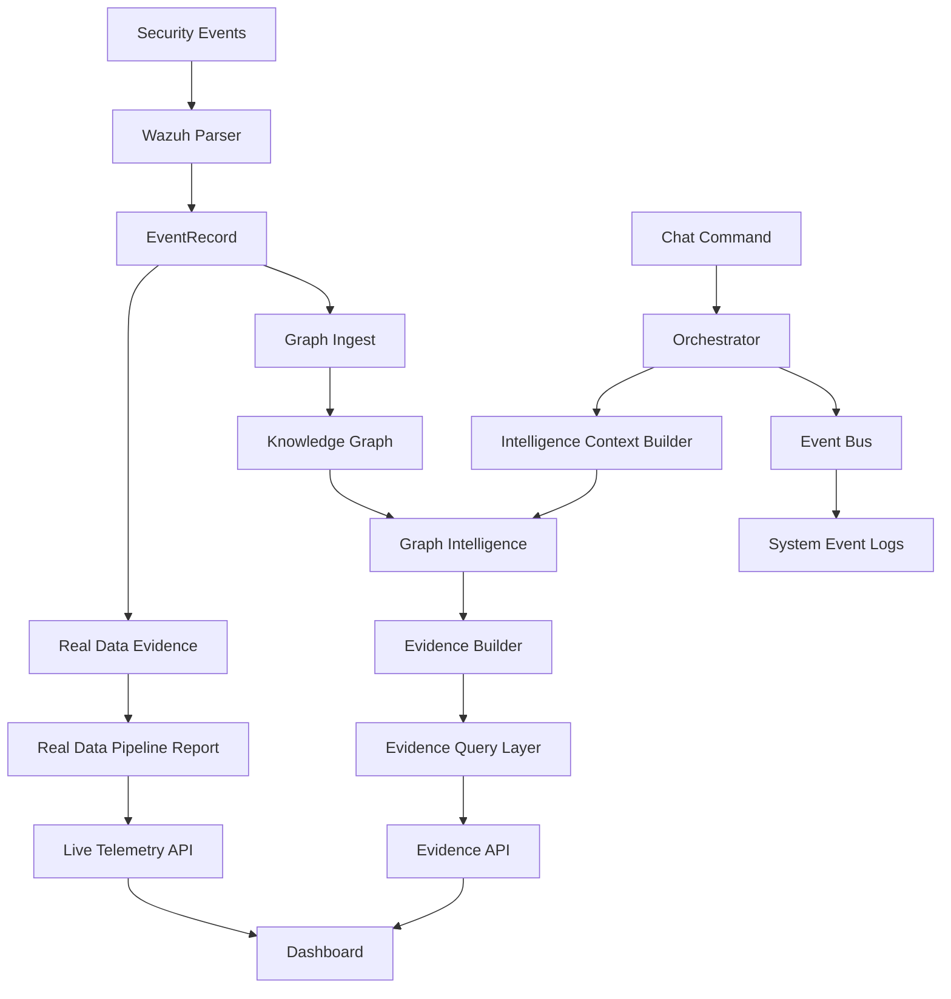

# Claude Context Package

## Purpose

This document gives a new AI reviewer enough context to understand Huginn/Muninn in under 10 minutes.

Huginn/Muninn is an early-stage defensive intelligence platform. It combines SOC telemetry, graph-based reasoning, evidence-backed recommendations, and dashboard visibility into one evolving security operations system.

It is not just a chatbot and it is not just a lab folder. The project is moving toward an AI-assisted defensive operations platform where security events become graph entities, evidence records, telemetry summaries, and future investigation context.

## Project Vision

Huginn/Muninn is designed to help analysts:

- connect fragmented security events
- reconstruct attack paths
- preserve institutional memory
- identify evidence gaps
- generate explainable defensive recommendations
- reason over Wazuh telemetry and MITRE ATT&CK context
- build toward AI-assisted SOC workflows

The names come from Odin's ravens:

- Huginn represents thought, reasoning, orchestration, and decisions.
- Muninn represents memory, context, historical patterns, and retained knowledge.

The intended long-term direction is a defensive intelligence system that can ingest telemetry, enrich it with memory, explain what matters, and support analyst decision-making.

## Architecture Overview



## Current System Flow

### Chat Flow

```text
/chat
-> Orchestrator
-> USER_COMMAND_RECEIVED
-> IntelligenceContextBuilder
-> AI_CONTEXT_ENRICHED
-> AI_THINKING_STARTED
-> Decision Engine
-> Intelligence Graph routing
-> AI_DECISION_MADE
-> AI_TASK_EXECUTING
-> AI_TASK_COMPLETED
-> outcome tracking
-> pattern recording
-> memory write
```

The chat response contract remains:

```json
{
  "status": "accepted",
  "event_id": "..."
}
```

The final answer is not returned synchronously. Internal events drive the reasoning pipeline.

### Wazuh File-to-Intelligence Flow

```text
Wazuh alerts JSON file
-> Wazuh File Reader
-> Wazuh Parser
-> EventRecord list
-> Graph Ingest
-> Knowledge Graph entities
-> Real Data Evidence
-> reports/real-data-pipeline-output.json
-> Live Telemetry API
-> Dashboard
```

### Evidence Flow

```text
Knowledge Graph
-> Graph Intelligence
-> Evidence Builder
-> Evidence Query Layer
-> Evidence API
-> Evidence Dashboard Panel
```

## Implemented Components

### API Application

Location:

```text
apps/api/src/huginn_muninn_api/
```

Purpose:

FastAPI backend for chat, memory, graph intelligence, evidence, telemetry summaries, and dashboard-facing APIs.

Important files:

```text
apps/api/src/huginn_muninn_api/main.py
apps/api/src/huginn_muninn_api/core/orchestrator.py
apps/api/src/huginn_muninn_api/core/graph_intelligence_api.py
apps/api/src/huginn_muninn_api/core/evidence_api.py
apps/api/src/huginn_muninn_api/core/live_telemetry_api.py
apps/api/src/huginn_muninn_api/core/intelligence_context.py
```

### Event Bus

Location:

```text
apps/api/src/core/event_bus.py
```

Purpose:

In-memory async event bus for application events.

Current event types include:

- `USER_COMMAND_RECEIVED`
- `AI_CONTEXT_ENRICHED`
- `AI_THINKING_STARTED`
- `CONTEXT_SIGNATURE_CREATED`
- `PATTERN_MATCH_LOOKUP`
- `AI_DECISION_MADE`
- `AI_PLAN_CREATED`
- `AI_TASK_EXECUTING`
- `AI_TASK_COMPLETED`
- `AI_OUTCOME_RECORDED`
- `AI_PATTERN_RECORDED`
- `MEMORY_WRITTEN`
- `AGENT_STATUS_UPDATED`

### Orchestrator

Location:

```text
apps/api/src/huginn_muninn_api/core/orchestrator.py
```

Purpose:

Coordinates chat commands, memory, decision routing, reasoning patterns, outcomes, and event emission.

Recent addition:

The Orchestrator now uses `IntelligenceContextBuilder` to enrich chat requests with lightweight graph context before the main reasoning pipeline continues.

### Intelligence Context Builder

Location:

```text
apps/api/src/huginn_muninn_api/core/intelligence_context.py
```

Purpose:

API-safe graph context enrichment for chat.

It:

- uses `GraphIntelligenceApi`
- does not import `core/graph_intelligence.py` directly
- detects MITRE IDs such as `T1059`, `T1078`, and `T1562.001`
- fetches graph summary
- fetches related graph entities for detected MITRE IDs
- returns JSON-safe context

### Knowledge Graph

Location:

```text
core/knowledge_graph.py
core/graph_context_builder.py
reports/knowledge-graph.json
core/patterns/knowledge-graph-summary.json
```

Purpose:

Stores events, MITRE techniques, attack chains, memory entries, architecture weaknesses, and defense recommendations as connected graph objects.

### Graph Intelligence

Locations:

```text
core/graph_intelligence.py
apps/api/src/huginn_muninn_api/core/graph_intelligence_api.py
reports/graph-intelligence-report.json
```

Purpose:

Allows Huginn/Muninn to ask useful questions about the graph:

- find related entities
- find connected weaknesses
- find recommendations for a technique
- find similar incidents

### Evidence Layer

Locations:

```text
core/evidence_schema.py
core/evidence_builder.py
core/evidence_query.py
apps/api/src/huginn_muninn_api/core/evidence_api.py
reports/evidence-index.json
reports/evidence-builder-output.json
reports/evidence-query-output.json
```

Purpose:

Turns graph findings into explainable evidence records with confidence scoring and related entities.

### Real Data Pipeline

Locations:

```text
core/ingest/wazuh_parser.py
core/ingest/wazuh_file_reader.py
core/ingest/graph_ingest.py
core/ingest/real_data_evidence.py
core/ingest/wazuh_pipeline.py
reports/real-data-pipeline-output.json
```

Purpose:

Processes Wazuh-style alert files into normalized events, graph nodes, and evidence records.

### Live Telemetry Dashboard

Locations:

```text
apps/api/src/huginn_muninn_api/core/live_telemetry_api.py
apps/web/app/page.tsx
docs/LIVE_TELEMETRY_DASHBOARD.md
```

Purpose:

Shows security telemetry summaries in the dashboard using existing JSON report data.

Widgets include:

- Recent Security Events
- Severity Breakdown
- Top Rule IDs
- Top Agents
- Evidence Summary
- Evidence Gaps Panel

## Milestones Completed

### Milestone 1: Graph Intelligence

Completed:

- Knowledge Graph MVP
- Graph Intelligence queries
- Graph Intelligence API
- Graph Intelligence dashboard panel

### Milestone 2: Evidence Layer

Completed:

- Evidence schema
- Evidence builder
- Evidence query layer
- Evidence API
- Evidence dashboard panel

### Milestone 3: Real Data Pipeline

Completed:

- Wazuh parser
- Graph ingest
- Real data evidence generation
- Sample reports

### Milestone 4: Wazuh File-to-Intelligence Pipeline

Completed:

- Wazuh file reader
- Wazuh file-to-intelligence pipeline
- Pipeline output report
- Live Wazuh integration plan

### Milestone 5: Live Telemetry Intelligence Dashboard

Completed:

- Dashboard telemetry API
- Dashboard section for live telemetry visibility
- severity, rule, agent, evidence, and gap summaries

### Milestone 6: Chat Intelligence Context Enrichment

Completed:

- `IntelligenceContextBuilder`
- `AI_CONTEXT_ENRICHED` event
- Orchestrator graph context enrichment
- tests for MITRE detection and chat enrichment events

## Current Metrics

Knowledge Graph:

```text
Total nodes: 43
Total relationships: 42
```

Node counts:

```text
Architecture Weakness: 3
Attack Chain: 1
Defense Recommendation: 4
Event: 28
MITRE Technique: 4
Memory Entry: 3
```

Relationship counts:

```text
caused_by: 3
previously_seen_as: 9
recommends: 4
relates_to: 18
weakens: 8
```

Top connected entities:

- `attack-chain:sim-full-lifecycle-001`
- `mitre:T1078`
- `mitre:T1087`
- `mitre:T1110`
- `weakness:15953a2c-3b98-4640-9401-1306f95162e3`

Real data pipeline sample:

```text
records_read: 3
records_parsed: 2
records_skipped: 1
events_added: 2
techniques_added: 2
relationships_added: 2
evidence_records_created: 2
evidence_gaps_created: 1
```

## Current Test Counts

Latest focused regression result:

```text
85 focused tests passing
```

Validated areas:

- Knowledge Graph
- Graph Intelligence
- Graph API
- Evidence schema
- Evidence builder
- Evidence query
- Evidence API
- Wazuh parser
- Graph ingest
- Real data evidence
- Wazuh file reader
- Wazuh pipeline
- Live telemetry API
- Intelligence context builder
- Chat orchestration events

## Key API Endpoints

Health:

```text
GET /health
```

Chat and events:

```text
POST /chat
GET /events
```

Memory:

```text
POST /memory
POST /memory/search
```

Security:

```text
POST /security/analyze
```

Graph Intelligence:

```text
GET /graph/summary
GET /graph/related/{entity_id}
GET /graph/weaknesses/{entity_id}
GET /graph/recommendations/{technique_id}
GET /graph/similar-incidents/{event_id}
```

Evidence:

```text
GET /evidence/summary
GET /evidence/finding/{finding_id}
GET /evidence/mitre/{technique_id}
GET /evidence/weakness/{weakness_id}
GET /evidence/recommendation/{recommendation_id}
GET /evidence/confidence/{level}
```

Dashboard telemetry:

```text
GET /dashboard/summary
GET /dashboard/events
GET /dashboard/rules
GET /dashboard/agents
GET /dashboard/evidence
```

## Dashboard Capabilities

Location:

```text
apps/web/app/page.tsx
```

Current dashboard sections:

- Conversation interface
- Command State
- Event Stream
- Decision Graph
- Reasoning Intelligence
- Graph Intelligence
- Evidence
- Live Telemetry Intelligence
- Learning Loop
- System Layers
- Security Analysis

The dashboard is an MVP command center. It is intentionally simple and avoids complex graph visualization libraries for now.

## Evidence Layer Overview

The Evidence Layer answers:

```text
What proof supports this finding?
How confident is the system?
Which events, techniques, weaknesses, recommendations, and memories are linked?
```

Evidence records include:

- evidence ID
- title
- summary
- source type
- source reference
- timestamp
- related entities
- confidence score
- confidence explanation

Confidence scoring considers:

- source reliability
- MITRE mapping
- entity correlation
- repeat observation
- severity alignment
- recency
- rule context
- host context

Evidence gaps are first-class findings, not ignored failures.

## Real Data Pipeline Overview

The Wazuh pipeline currently supports copied JSON alert files.

It can:

- read a Wazuh-style alert file
- skip malformed records safely
- normalize valid alerts into `EventRecord`
- extract Wazuh rule ID, timestamp, host, severity, description, and MITRE IDs
- add events and MITRE techniques to the graph
- generate evidence records
- create a pipeline output report

Known validated live-lab context:

- Wazuh is running
- Windows agent is connected
- `alerts.json` exists
- copied alert samples contain real Wazuh alerts
- Security channel events are flowing
- Event `4726` exists locally on Windows but was not reaching Wazuh alerts or archives
- that issue is a telemetry collection gap, not a Huginn pipeline failure

## Live Telemetry Dashboard Overview

The Live Telemetry Dashboard turns existing report JSON into dashboard-ready summaries.

It shows:

- recent events
- severity distribution
- top Wazuh rule IDs
- top agents
- evidence generated
- evidence gaps

It currently reads generated reports. It does not yet watch a live Wazuh file or poll a Wazuh API.

## Repository Structure

High-level layout:

```text
apps/
  api/
    src/
      core/
      huginn_muninn_api/
    tests/
  web/
    app/
core/
  ingest/
  patterns/
detection-engine/
docs/
evidence/
labs/
playbooks/
reports/
scripts/
templates/
```

Important directories:

```text
apps/api/src/huginn_muninn_api/
```

Runtime API application.

```text
apps/api/src/core/
```

API-side event bus, decision engine, intelligence graph, outcome tracker, and reasoning patterns.

```text
core/
```

Repository-level SOC intelligence, graph, evidence, telemetry, and defensive analysis modules.

```text
reports/
```

JSON artifacts used as memory, outputs, and dashboard data sources.

```text
docs/
```

Milestone notes, deployment plans, architecture notes, and implementation plans.

## Known Limitations

Current limitations:

- No production deployment.
- No authentication.
- No database persistence for the graph/evidence system yet.
- Dashboard is early-stage.
- Voice layer is not implemented.
- Suricata live ingest is not implemented.
- Wazuh live file watching is not implemented.
- Wazuh NDJSON support is still a recommended next step.
- Real Wazuh alert files must not be committed.
- Raw private telemetry must be sanitized before screenshots or portfolio use.
- The local Homebrew Node environment has had build instability; use Node 22.
- Some intelligence modules are report-driven rather than fully runtime-integrated.

## Roadmap

Recommended next phases:

1. Wazuh NDJSON Support
2. Controlled Wazuh Ingestion API
3. Evidence Query Dashboard Enhancements
4. Telemetry Gap Detection
5. Suricata Parser
6. Attack Chain Dashboard View
7. Prediction Engine
8. Autonomous Investigation Assistant
9. Voice Layer

Do not jump straight to autonomous investigation before telemetry quality and evidence traceability are stronger.

## How To Explain The Project Quickly

### Explain Like I Am 10

Wazuh writes security alerts.

Huginn reads the alerts and thinks about what they mean.

Muninn remembers old alerts, patterns, and evidence.

The Knowledge Graph is like a map that connects alerts, attacks, weaknesses, and recommendations.

The dashboard shows what Huginn knows, what evidence exists, and what information is missing.

### Explain Like I Am A SOC Analyst

Huginn/Muninn normalizes Wazuh telemetry, maps it into graph entities, connects those entities to MITRE ATT&CK context, generates evidence records, and exposes the result through API and dashboard views.

It is useful for visibility, triage context, evidence traceability, and identifying telemetry gaps.

### Explain Like I Am A Hiring Manager

This project demonstrates defensive security engineering across backend APIs, data modeling, event-driven design, SOC telemetry normalization, MITRE ATT&CK mapping, evidence-based reporting, and dashboard UX.

It shows the ability to build practical security tooling incrementally while preserving architectural boundaries and test coverage.

## Reviewer Notes

If reviewing or extending this project:

- Keep changes small.
- Do not modify detection rules unless explicitly asked.
- Do not commit raw Wazuh logs.
- Prefer JSON/report-driven MVPs before databases.
- Prefer API-safe adapters in `apps/api/src/huginn_muninn_api/core/`.
- Avoid importing repository-level graph modules directly into FastAPI startup if an API-safe adapter already exists.
- Preserve the `/chat` response contract.
- Add tests for any new API or orchestration behavior.
