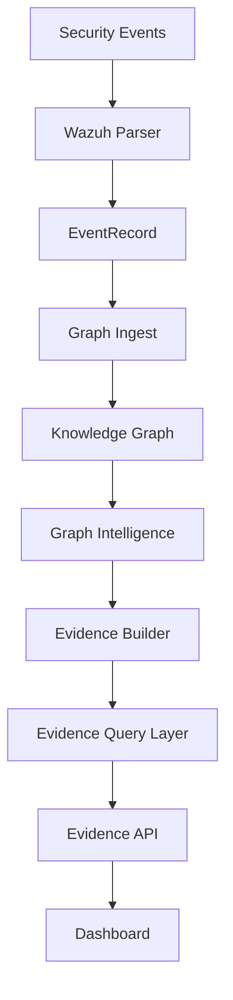

# Huginn/Munnin Current Platform State

## Current Architecture



Plain flow:

```text
Security Events
↓
Wazuh Parser
↓
EventRecord
↓
Graph Ingest
↓
Knowledge Graph
↓
Graph Intelligence
↓
Evidence Builder
↓
Evidence Query Layer
↓
Evidence API
↓
Dashboard
```

Huginn/Munnin is now an early-stage defensive intelligence platform with three working intelligence foundations:

- graph-based security context
- evidence-backed findings
- first-pass real Wazuh alert normalization and graph/evidence integration

## Implemented Components

### Knowledge Graph

Location:

```text
core/knowledge_graph.py
core/graph_context_builder.py
reports/knowledge-graph.json
core/patterns/knowledge-graph-summary.json
```

Purpose:

Stores security entities as connected graph nodes and relationships.

Supported node types:

- Event
- MITRE Technique
- Attack Chain
- Memory Entry
- Architecture Weakness
- Defense Recommendation

Supported relationship types:

- relates_to
- caused_by
- recommends
- previously_seen_as
- weakens

### Graph Intelligence

Location:

```text
core/graph_intelligence.py
reports/graph-intelligence-report.json
```

Purpose:

Lets Huginn ask useful questions about the Knowledge Graph.

Current query capabilities:

- find related entities
- find connected weaknesses
- find recommendations for a MITRE technique
- find similar incidents

### Graph Intelligence API

Location:

```text
apps/api/src/huginn_muninn_api/core/graph_intelligence_api.py
apps/api/src/huginn_muninn_api/main.py
```

Purpose:

Exposes graph intelligence through read-only FastAPI endpoints.

Endpoints:

```text
GET /graph/summary
GET /graph/related/{entity_id}
GET /graph/weaknesses/{entity_id}
GET /graph/recommendations/{technique_id}
GET /graph/similar-incidents/{event_id}
```

### Evidence Schema

Location:

```text
core/evidence_schema.py
reports/evidence-index.json
```

Purpose:

Defines traceable evidence records with related entities and confidence scoring.

### Evidence Builder

Location:

```text
core/evidence_builder.py
reports/evidence-builder-output.json
```

Purpose:

Builds evidence records from existing graph intelligence relationships.

### Evidence Query Layer

Location:

```text
core/evidence_query.py
reports/evidence-query-output.json
```

Purpose:

Lets Huginn search existing evidence by finding, MITRE technique, weakness, recommendation, and confidence level.

### Evidence API

Location:

```text
apps/api/src/huginn_muninn_api/core/evidence_api.py
apps/api/src/huginn_muninn_api/main.py
```

Purpose:

Exposes evidence search through read-only FastAPI endpoints.

Endpoints:

```text
GET /evidence/summary
GET /evidence/finding/{finding_id}
GET /evidence/mitre/{technique_id}
GET /evidence/weakness/{weakness_id}
GET /evidence/recommendation/{recommendation_id}
GET /evidence/confidence/{level}
```

### Dashboard

Location:

```text
apps/web/app/page.tsx
```

Purpose:

Provides a simple command center view for Huginn/Munnin.

Current panels include:

- Conversation
- Event Stream
- Decision Graph
- Reasoning Intelligence
- Graph Intelligence
- Evidence
- Learning Loop
- System Layers
- Security Analysis

### Wazuh Parser

Location:

```text
core/ingest/wazuh_parser.py
```

Purpose:

Parses a raw Wazuh alert JSON dictionary into a normalized `EventRecord`.

Extracts:

- alert ID
- timestamp
- rule ID
- rule description
- agent name
- MITRE technique IDs
- severity

### Graph Ingest

Location:

```text
core/ingest/graph_ingest.py
reports/real-data-graph-ingest-output.json
```

Purpose:

Adds normalized Wazuh `EventRecord` objects to the Knowledge Graph as Event nodes, MITRE Technique nodes, and `relates_to` relationships.

### Real Data Evidence Generation

Location:

```text
core/ingest/real_data_evidence.py
reports/real-data-evidence-output.json
```

Purpose:

Creates Evidence Layer records from normalized Wazuh events.

Events with MITRE mappings become higher-confidence evidence.

Events without MITRE mappings become evidence-gap records.

## Current Metrics

| Area | Current Status |
|---|---|
| Knowledge Graph | Active |
| Knowledge Graph Size | 43 nodes / 42 relationships |
| Graph Intelligence | Active |
| Evidence Layer | Schema, builder, query layer, API, and dashboard panel complete |
| Evidence Records | Existing sample evidence plus real-data evidence output |
| Real Data Pipeline | Wazuh parser, graph ingest, and real-data evidence generation complete |
| API | FastAPI graph and evidence endpoints available |
| Dashboard | Graph Intelligence and Evidence panels implemented |
| Focused Tests | 58 passing |

## Completed Milestones

### Milestone 1 — Graph Intelligence

Completed:

- Knowledge Graph MVP
- Graph summary report
- Graph Intelligence query functions
- Graph Intelligence sample report
- Graph API endpoints
- Graph Intelligence dashboard panel

Outcome:

Huginn can ask questions about connected security context instead of treating alerts as isolated objects.

### Milestone 2 — Evidence Layer

Completed:

- Evidence schema
- Confidence model
- Evidence Builder
- Evidence Query Layer
- Evidence API
- Evidence dashboard panel
- Evidence output reports

Outcome:

Huginn can support findings and recommendations with traceable evidence records.

### Milestone 3 — Real Data Pipeline

Completed:

- Wazuh Parser
- Graph Ingest
- Real Data Evidence Generation
- Sample real-data graph ingest report
- Sample real-data evidence report

Outcome:

Huginn/Munnin now has the first safe path from real Wazuh-style alert data into normalized events, graph context, and evidence records.

## Known Limitations

- Wazuh ingestion currently accepts alert dictionaries, not full alert files.
- No Wazuh file reader exists yet.
- No Suricata parser exists yet.
- No live Wazuh API integration exists yet.
- No live Suricata `eve.json` tailing exists yet.
- No API endpoints exist for real-data ingestion.
- Real-data graph ingest does not automatically update the committed `reports/knowledge-graph.json`.
- Evidence generation is file/JSON based and not database backed.
- The dashboard does not yet show real-data ingestion status.
- The local Homebrew Node/npm environment still makes `next build` unreliable.
- The system is not production deployed.
- No authentication or access control has been added.
- No automatic detection rule tuning or deployment is implemented.

## Recommended Next Phase

Recommended next phase:

```text
Real Data Phase 1D: Wazuh File Ingest
```

Why:

The system can parse one Wazuh alert dictionary, add normalized events to the graph, and generate evidence records. The next smallest useful step is to read a local Wazuh alert file containing multiple alerts and run the same pipeline end to end.

Phase 1D should:

- read a local Wazuh JSON file
- parse each alert with the existing Wazuh Parser
- produce normalized `EventRecord` objects
- run Graph Ingest
- run Real Data Evidence Generation
- save one ingestion summary report

Do not add yet:

- live Wazuh API calls
- streaming ingestion
- databases
- queues
- dashboard redesign
- automatic rule changes

## Hiring Manager Summary

Huginn/Munnin is an early-stage defensive intelligence platform that connects security events, MITRE ATT&CK context, graph intelligence, and evidence-backed reasoning.

The platform now demonstrates:

- structured security data modeling
- graph-based threat context
- MITRE-aligned relationships
- evidence and confidence modeling
- read-only FastAPI integration
- dashboard visibility
- real Wazuh-style alert normalization
- real-data event-to-graph transformation
- real-data evidence generation
- disciplined incremental engineering

The current system does not claim to be a production SIEM replacement. It shows a credible architecture for turning SOC telemetry into explainable defensive intelligence.

## 10-Year-Old Summary

Huginn is the thinker.

Munnin is the memory.

Security alerts are clues.

The Wazuh Parser cleans up the clues.

The Knowledge Graph puts the clues on a map.

Graph Intelligence asks questions about the map.

The Evidence Layer makes proof cards.

The API lets other tools ask for the proof cards.

The dashboard shows the map and proof cards on the screen.

Now Huginn/Munnin can take a Wazuh alert, turn it into a clean card, put it on the map, connect it to an attack technique, and create a proof card from it.
