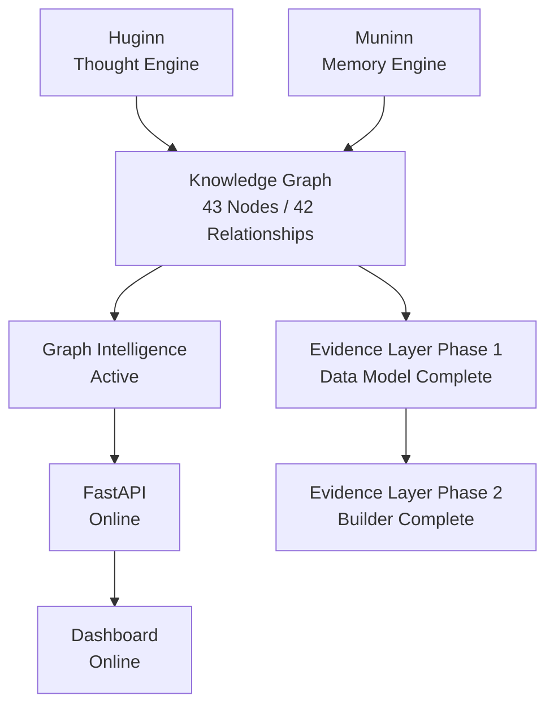

# Huginn/Munnin Current Platform State

## Current Status

| Layer | Status |
|---|---|
| Huginn | Online |
| Muninn | Online |
| Knowledge Graph | Active |
| Graph Intelligence | Active |
| Evidence Layer Phase 1 | Complete |
| Evidence Layer Phase 2 | Complete |
| Dashboard | Online |
| API | Online |

## Metrics

| Metric | Current Value |
|---|---:|
| Knowledge Graph Nodes | 43 |
| Knowledge Graph Relationships | 42 |
| Focused Tests Passing | 26 |

## System View



## Screenshots

Add current screenshots here when preparing portfolio or interview proof.

### System Layers

```text
screenshots/system-layers.png
```

Expected screenshot content:

- Huginn layer
- Muninn layer
- Knowledge Graph
- Graph Intelligence
- Evidence Layer Phase 1 and Phase 2
- API and Dashboard status

### Security Analysis

```text
screenshots/security-analysis.png
```

Expected screenshot content:

- Security Analysis dashboard section
- Input or analyzed security text
- Severity or analysis output
- No secrets, tokens, or private paths

### Graph Intelligence

```text
screenshots/graph-intelligence.png
```

Expected screenshot content:

- Graph Intelligence dashboard panel
- Total nodes: 43
- Total relationships: 42
- Related entities
- Weaknesses
- Recommendations
- Similar incidents

## Evidence Layer Status

Phase 1 is complete.

Phase 1 added:

- Evidence object schema
- Supporting models and types
- Confidence scoring model
- Sample evidence data
- Unit tests
- Documentation

Phase 2 is complete.

Phase 2 added:

- Evidence Builder
- Generated evidence records from graph relationships
- Evidence links to events, MITRE techniques, weaknesses, recommendations, and memory entries
- Evidence builder output report
- Unit tests
- Documentation

## Current Validation

Focused validation currently reports:

```text
26 focused tests passing
```

The focused test coverage includes:

- Knowledge Graph
- Graph Intelligence
- Graph API
- Evidence Data Model
- Evidence Builder

## Next Milestone

```text
Evidence Query Layer
```

## Why The Next Milestone Matters

The Evidence Builder creates proof records.

The Evidence Query Layer will make those proof records searchable.

It should let Huginn ask:

- What evidence supports this MITRE technique?
- What evidence supports this architecture weakness?
- What evidence supports this recommendation?
- What evidence connects to this event?
- What evidence has the highest confidence?

Explain like I am 10:

Huginn now has proof cards. The next step is giving Huginn a way to search the proof cards quickly.
