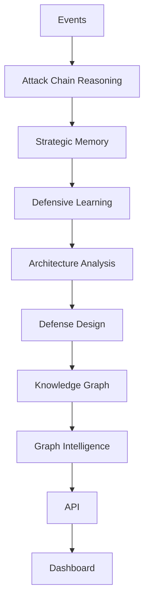
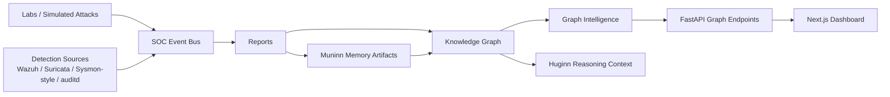
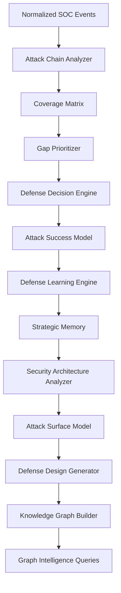

# Huginn/Munnin Current Platform State

## Executive Summary

Huginn/Munnin is an early-stage defensive intelligence platform that combines SOC detection engineering concepts with AI-oriented reasoning, memory, and decision support.

Huginn is the thought layer. It represents the reasoning side of the system: event routing, attack-chain analysis, defensive decision support, architecture analysis, and future AI-assisted investigation workflows.

Muninn is the memory layer. It represents stored operational knowledge: past events, outcomes, recurring weaknesses, learned defensive patterns, reports, and graph-connected security context.

The project exists to answer a practical security problem: isolated alerts are not enough. A SOC needs to understand how events connect, which attack phases are visible, where telemetry is weak, what defenses should improve first, and how past outcomes should influence future decisions.

The current platform does not try to be a production SIEM replacement. It is a structured defensive intelligence system that turns lab events, detections, reports, and architectural findings into a queryable knowledge layer.

## Current Architecture

Current high-level flow:



Current system boundaries:



Current intelligence pipeline:



## Completed Modules

### Attack Chain Reasoning

Purpose: Reconstructs security activity as a sequence of MITRE-aligned attack techniques instead of isolated events.

Inputs: SOC events, lab events, MITRE technique mappings, detection outcomes.

Outputs: `reports/attack-chain-analysis.json`, chain phase classification, missing transition findings.

Current status: Implemented as an analytical core module. It produces structured attack-chain analysis from existing event data.

### Strategic Memory

Purpose: Stores long-term defensive intelligence patterns so repeated attack and failure combinations are remembered.

Inputs: Defense learning outputs, attack success model outputs, coverage trends, reports.

Outputs: `core/patterns/strategic-memory.json`.

Current status: Implemented as a recommendation-support memory layer. It does not automatically change detections.

### Defensive Learning

Purpose: Extracts recurring weaknesses and tracks how defensive posture changes over time.

Inputs: Attack success probability, defensive action plans, coverage matrix trends.

Outputs: `reports/defense-learning-insights.json`, `reports/defense-evolution-metrics.json`, `reports/defense-evolution-history.jsonl`, `core/patterns/defense-learning-insights.jsonl`.

Current status: Implemented as a learning loop that produces insights and metrics. It remains advisory.

### Attack Surface Modeling

Purpose: Maps defensive exposure across pre-auth, auth, and post-auth layers.

Inputs: Architecture weaknesses, attack chains, strategic memory, reports.

Outputs: `reports/attack-surface-model.json`.

Current status: Implemented. Current findings identify post-auth as an under-instrumented layer.

### Architecture Analysis

Purpose: Identifies structural defensive weaknesses instead of individual rule-level problems.

Inputs: Detection gaps, attack-chain analysis, post-auth weakness findings, strategic memory.

Outputs: `reports/security-architecture-weaknesses.json`.

Current status: Implemented. It produces architecture-level weakness reports and avoids modifying detection logic.

### Defense Design Generation

Purpose: Converts architecture weaknesses into defensive design recommendations.

Inputs: Architecture weakness reports, attack surface model, strategic memory.

Outputs: `reports/defense-design-recommendations.json`.

Current status: Implemented. Recommendations focus on subsystems, telemetry improvements, and correlation architecture rather than new detection rules.

### Knowledge Graph

Purpose: Converts reports, events, memory, weaknesses, recommendations, and MITRE techniques into connected nodes and relationships.

Inputs: Existing report artifacts, strategic memory, SOC events, architecture reports, defense recommendation reports.

Outputs: `reports/knowledge-graph.json`, `core/patterns/knowledge-graph-summary.json`.

Current status: Implemented as a JSON-backed MVP. No database is used.

### Graph Intelligence

Purpose: Lets Huginn ask useful questions about the knowledge graph.

Inputs: `reports/knowledge-graph.json`.

Outputs: Related entities, connected weaknesses, recommendations for techniques, similar incidents, and `reports/graph-intelligence-report.json`.

Current status: Implemented as read-only graph query functions.

### Graph Intelligence API

Purpose: Exposes Graph Intelligence through read-only FastAPI endpoints.

Inputs: Existing JSON graph and summary artifacts.

Outputs: JSON responses from `/graph/*` endpoints.

Current status: Implemented and validated locally after rebuilding the API virtual environment.

### Dashboard Integration

Purpose: Makes Graph Intelligence visible in the existing web dashboard.

Inputs: Graph Intelligence API responses.

Outputs: A simple dashboard panel showing graph summary, connected entities, weaknesses, recommendations, and similar incidents.

Current status: Implemented as a small UI panel. No complex graph visualization library is used yet.

## Knowledge Graph

Current statistics:

- 43 nodes
- 42 relationships

Node types:

- Event
- MITRE Technique
- Attack Chain
- Memory Entry
- Architecture Weakness
- Defense Recommendation

Relationship types:

- relates_to
- caused_by
- recommends
- previously_seen_as
- weakens

Current node counts:

| Node Type | Count |
|---|---:|
| Event | 28 |
| MITRE Technique | 4 |
| Attack Chain | 1 |
| Memory Entry | 3 |
| Architecture Weakness | 3 |
| Defense Recommendation | 4 |

Current relationship counts:

| Relationship Type | Count |
|---|---:|
| relates_to | 18 |
| caused_by | 3 |
| recommends | 4 |
| previously_seen_as | 9 |
| weakens | 8 |

Explain like I am 10 years old:

The knowledge graph is a map. Each node is a card on the map. A card can be an alert, an attack trick, a weak spot, or a fix idea. Each relationship is a string connecting two cards. The strings explain how the cards are connected.

For example, one card might say `T1078 Valid Accounts`. Another card might say `Post-auth activity lacks visibility`. A `weakens` string can connect them, meaning that weak visibility makes that attack technique more dangerous.

## Graph Intelligence

Current capabilities:

### `find_related_entities()`

Finds graph objects directly connected to a searched entity.

Huginn uses this to ask: "What is connected to this event, technique, weakness, or recommendation?"

### `find_connected_weaknesses()`

Finds architecture weaknesses connected to an event or MITRE technique.

Huginn uses this to ask: "What structural weakness makes this activity risky?"

### `find_recommendations_for_technique()`

Finds defensive recommendations tied to weaknesses associated with a MITRE technique.

Huginn uses this to ask: "If this technique matters, what should defenders improve?"

### `find_similar_incidents()`

Finds other events that share MITRE technique context with a searched event.

Huginn uses this to ask: "Have we seen something like this before?"

## API Layer

Current read-only Graph Intelligence endpoints:

```text
GET /graph/summary
GET /graph/related/{entity_id}
GET /graph/weaknesses/{entity_id}
GET /graph/recommendations/{technique_id}
GET /graph/similar-incidents/{event_id}
```

Working local startup command:

```bash
cd apps/api
.venv/bin/uvicorn --app-dir src huginn_muninn_api.main:app --host 127.0.0.1 --port 8000
```

### Example: `GET /graph/summary`

Request:

```bash
curl http://127.0.0.1:8000/graph/summary
```

Example response shape:

```json
{
  "entity_searched": "knowledge_graph",
  "summary": {
    "total_nodes": 43,
    "total_relationships": 42,
    "top_connected_entities": [
      {
        "id": "attack-chain:sim-full-lifecycle-001",
        "type": "Attack Chain",
        "label": "sim-full-lifecycle-001",
        "connection_count": 13
      }
    ]
  },
  "connected_entities": [],
  "weaknesses": [],
  "recommendations": [],
  "similar_incidents": [],
  "explanation": "This shows how many graph objects exist and which ones have the most connections."
}
```

### Example: `GET /graph/related/mitre:T1078`

Example response shape:

```json
{
  "entity_searched": "mitre:T1078",
  "normalized_entity": "mitre:T1078",
  "connected_entities": [
    {
      "id": "weakness:15953a2c-3b98-4640-9401-1306f95162e3",
      "type": "Architecture Weakness",
      "label": "Post-auth activity lacks architectural visibility and response coverage"
    }
  ],
  "weaknesses": [],
  "recommendations": [],
  "similar_incidents": [],
  "explanation": "This shows the graph objects directly connected to the searched entity."
}
```

### Example: `GET /graph/weaknesses/T1078`

Example response shape:

```json
{
  "entity_searched": "T1078",
  "normalized_entity": "mitre:T1078",
  "weaknesses": [
    {
      "id": "weakness:15953a2c-3b98-4640-9401-1306f95162e3",
      "type": "Architecture Weakness",
      "label": "Post-auth activity lacks architectural visibility and response coverage"
    }
  ],
  "explanation": "This shows architecture weaknesses connected to the event or technique."
}
```

### Example: `GET /graph/recommendations/T1078`

Example response shape:

```json
{
  "entity_searched": "T1078",
  "normalized_entity": "mitre:T1078",
  "recommendations": [
    {
      "type": "Defense Recommendation",
      "label": "Improve post-auth telemetry and correlation coverage"
    }
  ],
  "explanation": "This shows defense recommendations tied to weaknesses for the technique."
}
```

### Example: `GET /graph/similar-incidents/{event_id}`

Example response shape:

```json
{
  "entity_searched": "f26fa03a-6c8e-44ca-b906-12c974dcbcbf",
  "normalized_entity": "event:f26fa03a-6c8e-44ca-b906-12c974dcbcbf",
  "similar_incidents": [
    {
      "type": "Event",
      "label": "detection.alert",
      "similarity_reason": "Shares MITRE technique context with the searched event."
    }
  ],
  "explanation": "This shows other events that share MITRE technique context with the searched event."
}
```

## Dashboard

Current dashboard capabilities:

- Conversation interface
- Command state display
- Huginn thought engine status
- Muninn memory engine status
- Voice layer marked as planned
- SOC layer marked as scaffolded
- Security Analysis section
- Event stream display
- Reasoning Intelligence panel
- Learning Loop panel
- Graph Intelligence panel

The Graph Intelligence panel currently displays:

- Total graph nodes
- Total graph relationships
- Top connected entities
- Related entities for a sample MITRE technique
- Connected weaknesses
- Defense recommendations
- Similar incidents

### Screenshot Placeholders

Add screenshots later. Do not embed images in this file yet.

```text
screenshots/graph-intelligence-dashboard.png
screenshots/api-graph-summary.png
screenshots/architecture-view.png
screenshots/passing-test-results.png
```

## Testing

Current validation status:

- 13 passing API and graph tests
- API startup validation completed locally
- Graph Intelligence API returned JSON from `/graph/summary`
- Knowledge Graph validation completed through tests and generated report artifacts

Focused test command:

```bash
PYTEST_DISABLE_PLUGIN_AUTOLOAD=1 apps/api/.venv/bin/python -m pytest \
  apps/api/tests/test_knowledge_graph.py \
  apps/api/tests/test_graph_intelligence.py \
  apps/api/tests/test_graph_api.py \
  -q
```

Observed result:

```text
13 passed in 21.04s
```

API startup command:

```bash
cd apps/api
.venv/bin/uvicorn --app-dir src huginn_muninn_api.main:app --host 127.0.0.1 --port 8000
```

Graph Intelligence API validation:

```bash
curl http://127.0.0.1:8000/graph/summary
```

Expected result:

```text
JSON response containing total_nodes, total_relationships, and top_connected_entities
```

Knowledge Graph output files:

```text
reports/knowledge-graph.json
core/patterns/knowledge-graph-summary.json
reports/graph-intelligence-report.json
```

## Current Screenshots

Recommended screenshot references:

- Graph Intelligence Dashboard
- API Graph Summary
- Architecture View
- Passing Test Results

Do not embed images in this document. Keep screenshots local or in a private proof folder unless intentionally publishing them.

## Known Limitations

- The dashboard is early-stage and focused on visibility rather than polished SOC workflows.
- The memory corpus is limited to the current reports and generated artifacts.
- The system is not production deployed.
- Voice interaction is planned but not implemented.
- Wazuh, Suricata, Sysmon, and auditd integrations are represented structurally but are not connected as live production feeds.
- The system does not automatically modify detection rules.
- Prediction engine is not built.
- Autonomous investigation is not built.
- Knowledge Graph persistence is JSON-only.
- There is no graph database yet.
- There is no authentication layer on the local Graph Intelligence API.
- The dashboard does not yet include an interactive graph visualization.
- API startup depended on rebuilding a broken local virtual environment; this was an environment issue, not a source-code feature.

## Next Roadmap

### 1. Evidence Layer

Why it matters: The platform needs a stronger evidence model so every finding can point to supporting logs, reports, screenshots, timelines, and analyst notes.

Expected value: Makes the system more credible for SOC review, incident reporting, interviews, and future autonomous investigation.

### 2. Prediction Engine

Why it matters: Once the graph can describe what happened, the next step is estimating what may happen next.

Expected value: Enables risk forecasting, likely next technique prediction, and proactive defense prioritization.

### 3. Autonomous Investigation

Why it matters: Analysts need help collecting context, comparing history, identifying gaps, and drafting investigation summaries.

Expected value: Turns graph intelligence into workflow assistance rather than static reporting.

### 4. Executive Intelligence Layer

Why it matters: Security leaders need concise business-level summaries of technical defensive risk.

Expected value: Translates attack-chain exposure, coverage gaps, and architecture weaknesses into leadership-ready status and priorities.

## Explain Three Ways

### Explain Like I Am 10

Huginn/Munnin is like a smart security notebook.

Huginn thinks. Muninn remembers. When something suspicious happens, the system writes it down, connects it to attack tricks, remembers if it happened before, finds weak spots, and suggests what defenders should improve.

The Knowledge Graph is a map of clue cards. The Graph Intelligence tools let Huginn ask questions like:

- What is connected to this clue?
- What weak spot does this clue show?
- What fix should we think about?
- Have we seen this before?

### Explain Like I Am A SOC Analyst

Huginn/Munnin is a defensive intelligence platform that converts lab events, detection alerts, MITRE mappings, defensive reports, and architecture findings into a connected reasoning layer.

Instead of treating alerts as isolated records, it reconstructs attack chains, measures coverage, identifies weak phases, stores recurring patterns, and exposes graph-based queries through an API and dashboard.

Current value for a SOC workflow:

- Attack-chain reconstruction
- MITRE-aligned context
- Detection gap visibility
- Architecture-level weakness tracking
- Defensive recommendation linkage
- Similar incident lookup
- Evidence-driven reporting foundation

### Explain Like I Am A Hiring Manager

Huginn/Munnin demonstrates cybersecurity engineering, detection engineering, backend API design, frontend integration, and AI-system architecture thinking.

The project shows the ability to structure a security platform around real SOC concepts: MITRE ATT&CK, detection coverage, attack-chain reasoning, memory, defensive learning, and architecture-level recommendations.

It is not presented as a finished enterprise product. It is a credible early-stage platform that demonstrates how security data can be transformed into intelligence workflows.

## Resume / Portfolio Summary

### LinkedIn

Built Huginn/Munnin, an early-stage defensive intelligence platform that connects SOC events, MITRE ATT&CK techniques, attack-chain reasoning, strategic memory, architecture analysis, and defense recommendations into a JSON-backed Knowledge Graph with read-only Graph Intelligence APIs and dashboard visibility.

### Resume Project Section

Huginn/Munnin Defensive Intelligence Platform

- Built a modular SOC intelligence system using Python, FastAPI, Next.js, and JSON-backed graph artifacts.
- Implemented attack-chain reasoning, coverage analysis, strategic memory, defensive learning, architecture weakness analysis, and defense design recommendation modules.
- Created a Knowledge Graph with 43 nodes and 42 relationships across events, MITRE techniques, attack chains, memory entries, architecture weaknesses, and defense recommendations.
- Exposed Graph Intelligence through read-only API endpoints and dashboard panels for related entities, connected weaknesses, recommendations, and similar incidents.
- Validated graph/API functionality with 13 passing focused tests.

### Interview Discussion

Huginn/Munnin is my defensive intelligence platform project. The goal is to move beyond isolated alert handling and model how detections, attack chains, memory, architecture weaknesses, and recommendations connect. The current milestone includes a Knowledge Graph and Graph Intelligence API, allowing the system to answer questions such as what a technique is connected to, which architecture weaknesses matter, what recommendations apply, and whether similar incidents exist.

## Final Assessment

### 1. Most Impressive Current Capability

The strongest part of the platform is the full reasoning chain from security events and reports into a connected Knowledge Graph, then into API and dashboard visibility. It demonstrates a clear move from detection engineering artifacts toward defensive intelligence.

### 2. What Remains Unfinished

The platform still needs a stronger evidence layer, production-grade live integrations, authentication, richer dashboard workflows, prediction capability, autonomous investigation, and an interactive graph visualization.

### 3. Estimated Platform Maturity

Estimated maturity: 35%.

Reasoning: The core architecture and several intelligence modules exist, but production deployment, live integrations, user management, durable storage, autonomous workflows, and operational hardening are not complete.

### 4. Recommended Next Milestone

Recommended next milestone: Evidence Layer.

Reasoning: Prediction and autonomous investigation will be stronger if every graph node, weakness, recommendation, and report can point back to clear supporting evidence. Evidence makes future intelligence trustworthy.
