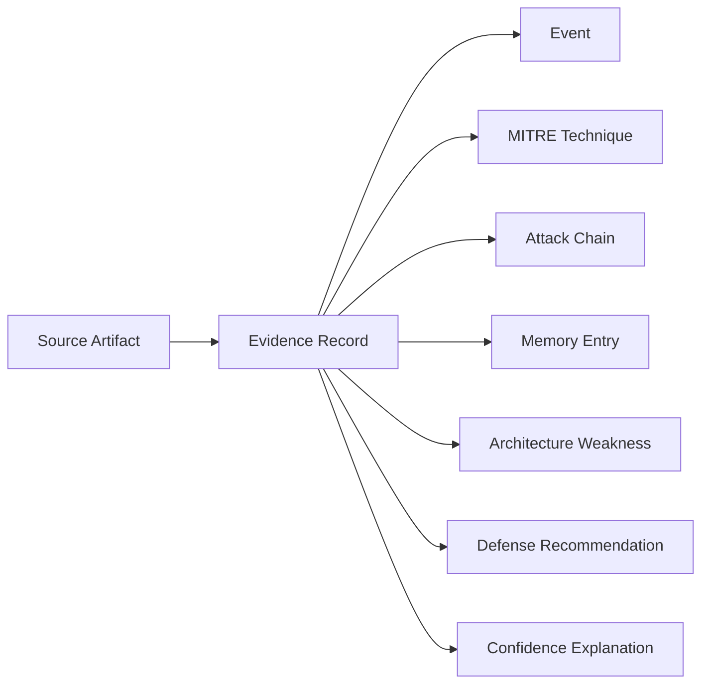
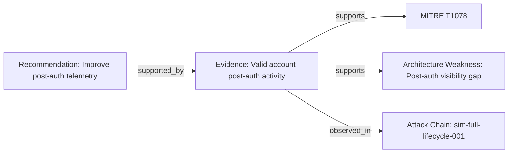

# Evidence Layer Design

## Purpose

The Evidence Layer makes Huginn/Muninn explainable.

Every important finding should answer:

```text
Why do we believe this?
```

Every recommendation should answer:

```text
What proof supports this recommendation?
```

Every confidence score should answer:

```text
How was this score calculated?
```

Explain like I am 10 years old:

Huginn is the thinker. Muninn is the memory. The Knowledge Graph is the map. The Evidence Layer is the proof box. If Huginn says, "This attack path is risky," the proof box shows the clues that explain why.

## Design Goals

1. Every finding must be traceable.
2. Every recommendation must include supporting evidence.
3. Every confidence score must explain how it was calculated.
4. Evidence must connect to:
   - Events
   - MITRE Techniques
   - Attack Chains
   - Memory Entries
   - Architecture Weaknesses

The Evidence Layer should be read-only at first. It should not modify detection rules, lab configuration, or automated response logic.

## Data Model

The Evidence Layer should introduce structured evidence records that connect source artifacts to graph entities.



Core data objects:

| Object | Purpose |
|---|---|
| Evidence Record | Stores one proof item |
| Evidence Source | Describes where the proof came from |
| Evidence Link | Connects evidence to graph entities |
| Confidence Breakdown | Explains the confidence score |
| Evidence Bundle | Groups evidence for a finding or recommendation |

## Evidence Object Schema

Smallest useful evidence object:

```json
{
  "evidence_id": "evidence:valid-account-post-auth-001",
  "title": "Valid account activity occurred during post-auth phase",
  "summary": "The attack chain includes T1078 Valid Accounts during the post-auth phase.",
  "source_type": "attack_chain_report",
  "source_path": "reports/attack-chain-analysis.json",
  "source_reference": "attack-chain:sim-full-lifecycle-001",
  "timestamp": "2026-06-01T18:43:55Z",
  "related_entities": {
    "events": [
      "event:64ef7517-c6bf-419f-99d1-2c6d93984694"
    ],
    "mitre_techniques": [
      "mitre:T1078"
    ],
    "attack_chains": [
      "attack-chain:sim-full-lifecycle-001"
    ],
    "memory_entries": [
      "memory:9a0bee3a-981c-4219-9211-ef546676c845"
    ],
    "architecture_weaknesses": [
      "weakness:15953a2c-3b98-4640-9401-1306f95162e3"
    ]
  },
  "confidence": {
    "score": 0.78,
    "level": "high",
    "calculation": {
      "source_reliability": 0.30,
      "entity_correlation": 0.25,
      "repeat_observation": 0.15,
      "recency": 0.08
    },
    "explanation": "Confidence is high because the technique appears in the attack chain, links to a known weakness, and is also present in memory."
  }
}
```

## Evidence Source Types

Supported source types should include:

| Source Type | Example |
|---|---|
| `soc_event` | Normalized event from `reports/soc-events.jsonl` |
| `lab_event` | Simulated attack step |
| `detection_alert` | Wazuh, Suricata, Sysmon-style alert |
| `attack_chain_report` | `reports/attack-chain-analysis.json` |
| `coverage_report` | `reports/coverage-matrix.json` |
| `gap_report` | `reports/prioritized-gaps.json` |
| `architecture_report` | `reports/security-architecture-weaknesses.json` |
| `defense_recommendation` | `reports/defense-design-recommendations.json` |
| `memory_pattern` | `core/patterns/strategic-memory.json` |
| `analyst_note` | Future manually written note |
| `screenshot_reference` | Future screenshot path |
| `command_output` | Future captured command result |

## Required Traceability

Every finding should include:

```json
{
  "finding_id": "finding:post-auth-visibility-gap",
  "finding_type": "architecture_weakness",
  "title": "Post-auth activity lacks visibility",
  "supporting_evidence": [
    "evidence:valid-account-post-auth-001",
    "evidence:account-discovery-post-auth-001"
  ],
  "related_graph_entities": [
    "mitre:T1078",
    "mitre:T1087",
    "weakness:15953a2c-3b98-4640-9401-1306f95162e3"
  ]
}
```

Every recommendation should include:

```json
{
  "recommendation_id": "recommendation:post-auth-telemetry",
  "title": "Improve post-auth telemetry and correlation coverage",
  "recommended_action": "Add telemetry and correlation coverage for valid account use and account discovery after authentication.",
  "supporting_evidence": [
    "evidence:valid-account-post-auth-001",
    "evidence:account-discovery-post-auth-001",
    "evidence:post-auth-weakness-001"
  ],
  "confidence": {
    "score": 0.82,
    "level": "high",
    "explanation": "Multiple connected evidence records show post-auth visibility gaps across attack-chain, memory, and architecture reports."
  }
}
```

## Confidence Scoring Approach

Confidence should be explainable, not magic.

The first version should use simple weighted scoring.

Suggested scoring inputs:

| Factor | Weight | Meaning |
|---|---:|---|
| Source reliability | 0.30 | How trustworthy the source artifact is |
| Entity correlation | 0.25 | How many graph entities support the same claim |
| Repeat observation | 0.20 | Whether the pattern appeared before |
| Recency | 0.10 | Whether the evidence is recent |
| Severity alignment | 0.15 | Whether severity matches the finding |

Example calculation:

```json
{
  "score": 0.78,
  "level": "high",
  "calculation": {
    "source_reliability": {
      "weight": 0.30,
      "value": 1.0,
      "weighted_score": 0.30
    },
    "entity_correlation": {
      "weight": 0.25,
      "value": 1.0,
      "weighted_score": 0.25
    },
    "repeat_observation": {
      "weight": 0.20,
      "value": 0.75,
      "weighted_score": 0.15
    },
    "recency": {
      "weight": 0.10,
      "value": 0.8,
      "weighted_score": 0.08
    },
    "severity_alignment": {
      "weight": 0.15,
      "value": 0.0,
      "weighted_score": 0.0
    }
  },
  "explanation": "The score is high because the source is reliable, the graph links multiple related entities, and similar evidence has appeared before."
}
```

Suggested confidence levels:

| Score Range | Level |
|---|---|
| 0.00-0.39 | Low |
| 0.40-0.69 | Medium |
| 0.70-1.00 | High |

Explain like I am 10 years old:

Confidence is like a school grade for proof. If Huginn has one weak clue, the score is low. If Huginn has many strong clues that all point to the same answer, the score is high.

## API Impact

The Evidence Layer should add read-only endpoints.

Expected endpoints:

```text
GET /evidence/summary
GET /evidence/entity/{entity_id}
GET /evidence/finding/{finding_id}
GET /evidence/recommendation/{recommendation_id}
GET /evidence/timeline
```

Example: `GET /evidence/entity/mitre:T1078`

```json
{
  "entity_searched": "mitre:T1078",
  "evidence_count": 3,
  "evidence": [
    {
      "evidence_id": "evidence:valid-account-post-auth-001",
      "title": "Valid account activity occurred during post-auth phase",
      "source_type": "attack_chain_report",
      "confidence": {
        "score": 0.78,
        "level": "high",
        "explanation": "The technique appears in the attack chain, links to a known weakness, and is present in memory."
      }
    }
  ],
  "explanation": "This evidence explains why mitre:T1078 matters in the current graph."
}
```

API rules:

- Read-only
- JSON-backed
- No database in the first version
- No detection rule changes
- No lab configuration changes
- No automatic response actions

## Dashboard Impact

The dashboard should add a small Evidence Intelligence panel.

Minimum useful dashboard fields:

- Total evidence records
- Evidence by source type
- Highest-confidence evidence
- Evidence linked to selected MITRE technique
- Evidence linked to selected architecture weakness
- Evidence timeline preview
- Confidence explanation text

Dashboard question to answer:

```text
Why does Huginn believe this?
```

Example panel layout:

```text
Evidence Intelligence

Evidence records: 12
High confidence: 5
Medium confidence: 6
Low confidence: 1

Selected entity: mitre:T1078

Top supporting evidence:
- Valid account activity occurred during post-auth phase
- Post-auth visibility gap found in architecture analysis
- Similar valid-account pattern previously recorded in memory

Why this matters:
This technique is connected to a post-auth visibility weakness and repeated memory patterns.
```

## Knowledge Graph Integration

The Evidence Layer should extend the Knowledge Graph by adding evidence as a first-class node type later.

Suggested new node type:

```text
Evidence
```

Suggested new relationship types:

```text
supported_by
supports
observed_in
derived_from
justifies
```

Example graph connection:



First MVP option:

The first Evidence Layer can keep evidence in separate JSON files and reference existing graph entity IDs. The graph schema can be expanded in a later step after evidence records are stable.

Recommended MVP files:

```text
reports/evidence-index.json
reports/evidence-timeline.json
reports/evidence-summary.json
core/patterns/evidence-confidence-summary.json
```

## Example Evidence Bundle

An evidence bundle groups proof for a finding or recommendation.

```json
{
  "bundle_id": "evidence-bundle:post-auth-visibility-gap",
  "title": "Evidence supporting post-auth visibility gap",
  "related_finding": "weakness:15953a2c-3b98-4640-9401-1306f95162e3",
  "evidence_ids": [
    "evidence:valid-account-post-auth-001",
    "evidence:account-discovery-post-auth-001",
    "evidence:strategic-memory-post-auth-001"
  ],
  "overall_confidence": {
    "score": 0.84,
    "level": "high",
    "explanation": "Three evidence records from attack-chain, graph, and memory artifacts support the same post-auth visibility weakness."
  }
}
```

## Phase 3 MVP Success Criteria

The Evidence Layer MVP is complete when:

- Evidence records exist in JSON.
- Evidence records link to graph entity IDs.
- Findings can list supporting evidence.
- Recommendations can list supporting evidence.
- Confidence scores include calculation details.
- API can return evidence for an entity.
- Dashboard can show a small evidence summary.
- Existing Graph Intelligence still works.
- No detection rules are changed.
- No lab configurations are changed.

## Final Explanation Like I Am 10

Right now Huginn can say:

```text
This attack trick connects to this weak spot.
```

The Evidence Layer lets Huginn also say:

```text
And here are the clues that prove it.
```

That matters because smart security tools should not just give answers. They should show their work.
