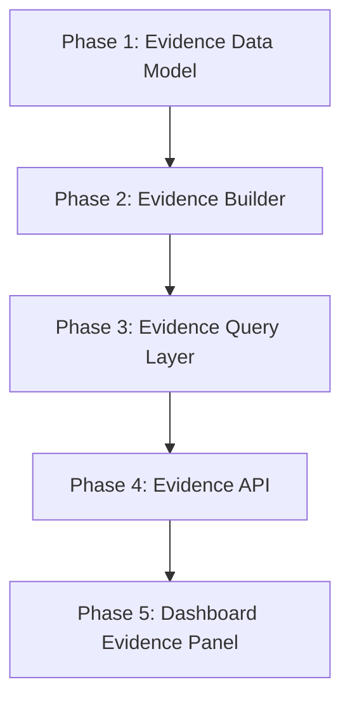

# Evidence Layer Implementation Plan

## Goal

Implement the Evidence Layer in small, safe phases.

The Evidence Layer should make Huginn/Muninn able to show proof for findings, recommendations, confidence scores, and graph relationships.

This plan is documentation only. It does not implement code.

## Core Principle

Build the smallest useful version first.

Do not start with:

- Database storage
- Autonomous investigation
- Prediction
- Complex evidence scoring
- Full dashboard redesign
- Automatic detection-rule changes

Start with:

```text
JSON evidence records linked to existing Knowledge Graph entities.
```

Explain like I am 10 years old:

Do not build a giant robot first. Build a small proof box first. Put clues in the box. Connect each clue to the right card on the map. Then Huginn can say, "I know this because of these clues."

## Phase Overview



Recommended implementation order:

1. Evidence Data Model
2. Evidence Builder
3. Evidence Query Layer
4. Evidence API
5. Dashboard Evidence Panel

## First MVP Version

The first MVP should only do this:

```text
Read existing reports and graph artifacts, create evidence records, and let the API return evidence for a graph entity.
```

MVP scope:

- JSON persistence only
- Read-only behavior
- No database
- No detection-rule changes
- No lab configuration changes
- No automatic investigation
- No prediction
- No advanced scoring model

MVP user story:

```text
As a SOC analyst, I can search evidence for mitre:T1078 and see which reports, events, and weaknesses support why that technique matters.
```

## Phase 1: Evidence Data Model

### Purpose

Define the evidence object structure.

### Required Files

```text
core/evidence_schema.py
reports/evidence-index.json
```

### Scope

Create simple structures for:

- Evidence record
- Evidence source
- Related graph entities
- Confidence breakdown

### Minimum Evidence Fields

```json
{
  "evidence_id": "evidence:example",
  "title": "Example evidence title",
  "summary": "Short explanation of the proof.",
  "source_type": "attack_chain_report",
  "source_path": "reports/attack-chain-analysis.json",
  "source_reference": "attack-chain:sim-full-lifecycle-001",
  "related_entities": {
    "events": [],
    "mitre_techniques": [],
    "attack_chains": [],
    "memory_entries": [],
    "architecture_weaknesses": []
  },
  "confidence": {
    "score": 0.7,
    "level": "high",
    "calculation": {},
    "explanation": "Simple reason for the confidence score."
  }
}
```

### Tests

Add focused tests for:

- Valid evidence object creation
- Required fields
- Confidence level mapping
- JSON serialization

### Success Criteria

- Evidence records have a consistent schema.
- Invalid confidence levels are rejected or normalized.
- Evidence can be written to JSON.

## Phase 2: Evidence Builder

### Purpose

Generate evidence records from existing reports.

### Required Files

```text
core/evidence_builder.py
reports/evidence-index.json
reports/evidence-summary.json
```

### Inputs

```text
reports/soc-events.jsonl
reports/attack-chain-analysis.json
reports/security-architecture-weaknesses.json
reports/defense-design-recommendations.json
reports/knowledge-graph.json
core/patterns/strategic-memory.json
```

### Outputs

```text
reports/evidence-index.json
reports/evidence-summary.json
```

### MVP Behavior

The builder should create evidence for:

- MITRE techniques found in attack chains
- Architecture weaknesses
- Defense recommendations
- Memory entries tied to recurring weaknesses

### Tests

Add focused tests for:

- Evidence generation from sample reports
- Evidence links to known graph entity IDs
- Empty/missing reports are handled safely
- Output is deterministic

### Success Criteria

- Evidence file is generated.
- Evidence links to existing graph entities.
- No detection rules are modified.
- No lab configs are modified.

## Phase 3: Evidence Query Layer

### Purpose

Let Huginn ask evidence questions without needing API routes yet.

### Required Files

```text
core/evidence_query.py
reports/evidence-timeline.json
```

### Required Functions

```text
find_evidence_for_entity(entity_id)
find_evidence_for_finding(finding_id)
find_evidence_for_recommendation(recommendation_id)
build_evidence_timeline()
summarize_confidence()
```

### Tests

Add focused tests for:

- Evidence lookup by MITRE technique
- Evidence lookup by architecture weakness
- Evidence lookup by recommendation
- Timeline ordering
- Confidence summary output

### Success Criteria

- Huginn can ask, "What evidence supports this entity?"
- Evidence queries work from JSON only.
- Query outputs are stable and easy to explain.

## Phase 4: Evidence API

### Purpose

Expose read-only evidence lookup through FastAPI.

### Required Files

```text
apps/api/src/huginn_muninn_api/core/evidence_api.py
apps/api/tests/test_evidence_api.py
```

### Required API Changes

Add read-only endpoints:

```text
GET /evidence/summary
GET /evidence/entity/{entity_id}
GET /evidence/finding/{finding_id}
GET /evidence/recommendation/{recommendation_id}
GET /evidence/timeline
```

### Example Response

```json
{
  "entity_searched": "mitre:T1078",
  "evidence_count": 2,
  "evidence": [
    {
      "evidence_id": "evidence:valid-account-post-auth-001",
      "title": "Valid account activity occurred during post-auth phase",
      "source_type": "attack_chain_report",
      "confidence": {
        "score": 0.78,
        "level": "high",
        "explanation": "The technique appears in the attack chain and links to a known architecture weakness."
      }
    }
  ],
  "explanation": "This evidence explains why mitre:T1078 matters."
}
```

### Tests

Add API tests for:

- `/evidence/summary`
- `/evidence/entity/{entity_id}`
- `/evidence/finding/{finding_id}`
- `/evidence/recommendation/{recommendation_id}`
- `/evidence/timeline`

### Success Criteria

- API returns evidence JSON.
- API reads existing evidence files only.
- API startup remains stable.
- Existing graph endpoints still pass.

## Phase 5: Dashboard Evidence Panel

### Purpose

Show evidence visibility in the dashboard.

### Required Files

```text
apps/web/app/page.tsx
```

### Required Dashboard Changes

Add a small Evidence Intelligence panel.

The panel should show:

- Total evidence records
- Evidence by source type
- Highest-confidence evidence
- Evidence for sample MITRE technique `T1078`
- Confidence explanation

### Avoid

Do not add:

- Complex graph visualization
- Full investigation workflow
- Prediction UI
- Upload system
- Authentication
- Database UI

### Tests

If web testing exists, add a basic rendering test. If not, validate manually through:

```text
API running -> dashboard loads -> Evidence Intelligence panel shows evidence data
```

### Success Criteria

- Dashboard shows evidence summary.
- Dashboard explains why a finding or technique matters.
- No existing dashboard panels are redesigned.

## Required Files Summary

Expected new files:

```text
core/evidence_schema.py
core/evidence_builder.py
core/evidence_query.py
apps/api/src/huginn_muninn_api/core/evidence_api.py
apps/api/tests/test_evidence_api.py
reports/evidence-index.json
reports/evidence-summary.json
reports/evidence-timeline.json
```

Expected modified files:

```text
apps/api/src/huginn_muninn_api/main.py
apps/web/app/page.tsx
docs/DEPLOYMENT_AND_TESTING_PLAN.md
```

Only modify dashboard/API files after the core evidence JSON and query layer work.

## Test Requirements

Minimum focused test set:

```text
test_evidence_schema.py
test_evidence_builder.py
test_evidence_query.py
test_evidence_api.py
```

Tests should validate:

- Evidence schema
- Confidence scoring
- JSON output
- Entity lookup
- Recommendation lookup
- Timeline creation
- API response shape
- Missing-file fallback behavior

Recommended command style:

```bash
PYTEST_DISABLE_PLUGIN_AUTOLOAD=1 apps/api/.venv/bin/python -m pytest \
  apps/api/tests/test_knowledge_graph.py \
  apps/api/tests/test_graph_intelligence.py \
  apps/api/tests/test_graph_api.py \
  apps/api/tests/test_evidence_api.py \
  -q
```

## Overall Success Criteria

The Evidence Layer MVP is successful when:

- Evidence records exist in JSON.
- Evidence links to Knowledge Graph entities.
- Findings can show supporting evidence.
- Recommendations can show supporting evidence.
- Confidence scores include calculations and explanations.
- API can return evidence by entity.
- Dashboard can show evidence summary.
- Existing Graph Intelligence still works.
- No detection logic is changed.
- No lab configuration is changed.
- No database is introduced.

## What To Avoid

Avoid overengineering:

- Do not add a graph database yet.
- Do not add vector search yet.
- Do not add autonomous investigation yet.
- Do not add prediction yet.
- Do not auto-generate detection rules.
- Do not build a complex evidence UI.
- Do not create a large plugin framework.

Keep the first version boring and useful.

## Explain Like I Am 10

Huginn already has a map.

Muninn already has memory.

Now they need a proof box.

Phase 1 makes the shape of a clue card.

Phase 2 fills the proof box with clue cards.

Phase 3 lets Huginn search the proof box.

Phase 4 lets the API show the proof.

Phase 5 lets the dashboard show the proof.

The first version should be small. It should only answer:

```text
What proof supports this?
```

## Explain Like I Am A SOC Analyst

The Evidence Layer turns the current graph and report artifacts into traceable analyst context.

Instead of only seeing that `T1078` connects to a post-auth weakness, the analyst can see which attack-chain report, event, memory entry, or architecture finding supports that conclusion.

The first version should improve explainability, not automation.

SOC value:

- Better finding justification
- Better recommendation support
- Better incident report traceability
- Better handoff from Tier 1 to Tier 2
- Better foundation for future investigation workflows

## Explain Like I Am A Hiring Manager

This phase demonstrates practical security engineering maturity.

The project already shows reasoning, memory, graph modeling, API design, and dashboard integration. The Evidence Layer adds an important professional capability: defensibility.

It shows that the system does not just produce conclusions. It can explain where conclusions came from, what supports them, and how confidence was calculated.

That is a strong signal for roles involving:

- SOC engineering
- Detection engineering
- Security automation
- Threat-informed defense
- AI-assisted security tooling

## Recommended First Implementation Ticket

Start with:

```text
Create core/evidence_schema.py and reports/evidence-index.json with three sample evidence records linked to existing Knowledge Graph entities.
```

Acceptance criteria:

- Evidence schema exists.
- Three sample evidence records exist.
- Each evidence record links to at least one existing graph entity.
- Each confidence score includes a calculation and explanation.
- No API or dashboard changes yet.

This is the smallest useful starting point.
