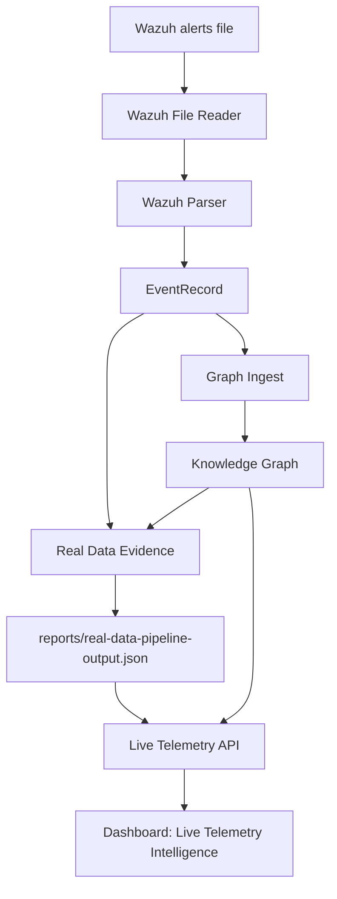

# Live Telemetry Intelligence Dashboard

## Purpose

The Live Telemetry Intelligence Dashboard makes real Wazuh pipeline output visible inside Huginn/Muninn.

The goal is not to build a full SOC console yet. The goal is to answer simple operational questions:

- What security events are reaching Huginn/Muninn?
- Which severities are most common?
- Which Wazuh rules are firing?
- Which agents are producing telemetry?
- How many evidence records were generated?
- Where are the evidence gaps?

## Architecture



## Data Sources

The dashboard uses existing data only.

Primary data source:

```text
reports/real-data-pipeline-output.json
```

Secondary data source:

```text
reports/knowledge-graph.json
```

The API derives dashboard summaries from:

- Wazuh pipeline output
- Evidence records
- Knowledge Graph event nodes

No database was added.

No Wazuh rules were modified.

No live file watching was added.

## API Support

Read-only endpoints:

```text
GET /dashboard/summary
GET /dashboard/events
GET /dashboard/rules
GET /dashboard/agents
GET /dashboard/evidence
```

These endpoints do not replace or modify the existing Evidence API.

## Dashboard Widgets

### Recent Security Events

Shows the latest available events from pipeline evidence and graph events.

Fields:

- Timestamp
- Rule ID
- Description
- Severity
- Source Agent

Limit:

```text
20 events
```

### Severity Breakdown

Returns chart-ready JSON for:

- Critical
- High
- Medium
- Low
- Informational

Each bucket includes:

- count
- percentage

### Top Rule IDs

Shows:

- Rule ID
- Description
- Occurrence Count

Limit:

```text
Top 10
```

### Top Agents

Shows:

- Agent Name
- Event Count

Limit:

```text
Top 10
```

### Evidence Summary

Shows:

- Total Evidence Records
- High Confidence
- Medium Confidence
- Low Confidence
- Evidence Gaps

### Evidence Gaps Panel

Flags evidence records where:

- MITRE technique is missing
- confidence is low
- recommendation is missing

Each gap includes a plain-English explanation.

## Example Output

Example `/dashboard/summary` shape:

```json
{
  "entity_searched": "live_telemetry",
  "recent_events": [
    {
      "timestamp": "2026-06-08T14:22:31.000Z",
      "rule_id": "60122",
      "description": "Multiple Windows logon failures",
      "severity": "high",
      "source_agent": "windows-endpoint-01"
    }
  ],
  "severity_breakdown": [
    {
      "severity": "high",
      "count": 1,
      "percentage": 50.0
    }
  ],
  "top_rules": [
    {
      "rule_id": "60122",
      "description": "Multiple Windows logon failures",
      "occurrence_count": 1
    }
  ],
  "top_agents": [
    {
      "agent_name": "windows-endpoint-01",
      "event_count": 1
    }
  ],
  "evidence": {
    "summary": {
      "total_evidence_records": 2,
      "high_confidence": 1,
      "medium_confidence": 0,
      "low_confidence": 1,
      "evidence_gaps": 2
    }
  }
}
```

## Validation

This phase adds focused tests for:

- dashboard summaries
- severity calculations
- rule aggregation
- agent aggregation
- evidence statistics

Existing graph, evidence, and Wazuh pipeline behavior should remain unchanged.

## Known Limitations

Current limitations:

- The dashboard reads generated report JSON, not a live Wazuh stream.
- There is no file watcher.
- There is no database.
- There is no historical trend view.
- The event fields are derived from existing evidence summaries when structured raw event fields are unavailable.
- Evidence gaps are recommendation-only and do not modify detections.

## Next Recommended Phase

Recommended next phase:

```text
Wazuh NDJSON Support
```

Why:

Real Wazuh `alerts.json` files are commonly newline-delimited JSON. The existing file reader supports a single JSON object or JSON list. NDJSON support would make copied Wazuh samples easier to process without manual conversion.

## Explain Like I Am 10

Wazuh writes security alerts.

Huginn reads those alerts and turns them into clean cards.

This dashboard shows the cards in a simple way:

- what happened
- how serious it was
- which rule found it
- which computer sent it
- what proof Huginn created
- what information is missing

It is like a scoreboard for security alerts.

## SOC Analyst Explanation

The Live Telemetry Intelligence Dashboard provides first-pass visibility into Wazuh-derived telemetry inside Huginn/Muninn.

It summarizes recent events, severity distribution, top rule IDs, top agents, evidence volume, confidence levels, and evidence gaps. This helps analysts quickly determine whether telemetry is flowing, whether MITRE context is present, and where enrichment or collection gaps exist.

The implementation remains read-only and report-driven. It does not alter Wazuh rules, detection logic, or response workflows.

## Hiring Manager Explanation

This phase turns the project from backend-only telemetry processing into visible operational intelligence.

It demonstrates the ability to:

- ingest real SOC telemetry
- normalize alert data
- aggregate security events
- expose read-only API summaries
- build analyst-facing dashboard widgets
- identify evidence and telemetry gaps
- preserve architecture boundaries

The result is still an MVP, but it shows a practical path from SIEM data to explainable security visibility.
