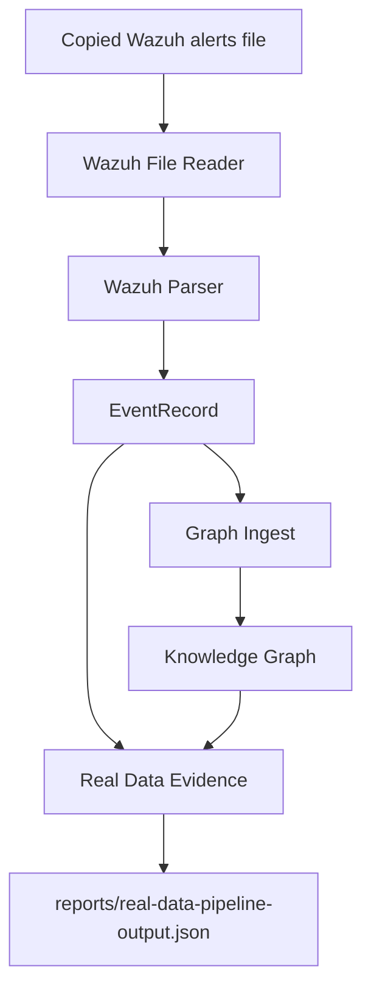

# Live Wazuh Integration Plan

## Goal

Safely connect Huginn/Muninn to real Wazuh alerts without exposing private security data, modifying Wazuh, or risking live SOC telemetry.

The likely Wazuh alert file path is:

```text
/var/ossec/logs/alerts/alerts.json
```

This plan uses a copy-first workflow. Huginn/Muninn should process copied alert samples before it ever reads the live Wazuh alert file directly.

## Safety Principles

Do this first:

- copy a small alert sample out of Wazuh
- test the copied file locally
- run the Huginn Wazuh pipeline against the copied file
- validate output reports
- sanitize anything used in screenshots or documentation

Do not do this yet:

- do not point Huginn/Muninn directly at the live Wazuh alert file as the first test
- do not commit raw real alert files
- do not publish real IPs, hostnames, usernames, hashes, internal paths, or private logs
- do not post unsanitized terminal output to GitHub, LinkedIn, or resumes

## Current Huginn/Muninn Pipeline



## Safe Read-Only Workflow

### Step 1: Locate Wazuh alerts.json

Run this on the Wazuh manager system:

```bash
sudo ls -lah /var/ossec/logs/alerts/alerts.json
```

If the file is not there, search common Wazuh alert locations:

```bash
sudo find /var/ossec -path "*alerts*" -name "alerts.json" -type f 2>/dev/null
```

Expected result:

```text
/var/ossec/logs/alerts/alerts.json
```

### Step 2: Check File Permissions

Run:

```bash
sudo stat /var/ossec/logs/alerts/alerts.json
```

Also check ownership and size:

```bash
sudo ls -lh /var/ossec/logs/alerts/alerts.json
```

What to look for:

- the file exists
- the file is readable by root or the Wazuh service account
- the file is not empty
- the file may be large, so do not copy the entire file for the first test

### Step 3: Copy A Small Sample

Create a safe local testing folder outside the repository:

```bash
mkdir -p ~/wazuh-alert-samples
```

Copy only a small sample from the live alerts file:

```bash
sudo tail -n 20 /var/ossec/logs/alerts/alerts.json > ~/wazuh-alert-samples/alerts-sample.json
```

Lock down the copied file:

```bash
chmod 600 ~/wazuh-alert-samples/alerts-sample.json
```

Check the copied sample:

```bash
wc -l ~/wazuh-alert-samples/alerts-sample.json
head -n 2 ~/wazuh-alert-samples/alerts-sample.json
```

Important:

Wazuh `alerts.json` is commonly newline-delimited JSON. If the copied sample contains one JSON object per line instead of a JSON list, the current Huginn/Muninn file reader may need a future NDJSON reader phase. For the current pipeline, test with valid JSON object or JSON list input.

### Step 4: Create A Valid Local Test File If Needed

If the sample is newline-delimited JSON, convert a very small sanitized subset into a JSON list manually or with a local trusted script outside the repository.

Example target shape:

```json
[
  {
    "id": "sample-alert-001",
    "timestamp": "2026-06-08T14:22:31.000Z",
    "agent": {
      "name": "sanitized-host"
    },
    "rule": {
      "id": "60122",
      "level": 10,
      "description": "Sanitized Wazuh alert",
      "mitre": {
        "id": ["T1110"]
      }
    }
  }
]
```

Save the sanitized test file outside the repository:

```text
~/wazuh-alert-samples/alerts-sample-sanitized.json
```

### Step 5: Run The Existing Huginn Wazuh Pipeline

From the repository root:

```bash
cd /Users/kingkilo/Documents/munnin
```

Run the pipeline against the copied or sanitized sample file:

```bash
apps/api/.venv/bin/python -c "from core.ingest.wazuh_pipeline import run_wazuh_file_pipeline; run_wazuh_file_pipeline('~/wazuh-alert-samples/alerts-sample-sanitized.json')"
```

If the shell does not expand `~` inside Python, use the full path:

```bash
apps/api/.venv/bin/python -c "from core.ingest.wazuh_pipeline import run_wazuh_file_pipeline; run_wazuh_file_pipeline('/Users/kingkilo/wazuh-alert-samples/alerts-sample-sanitized.json')"
```

Expected output file:

```text
reports/real-data-pipeline-output.json
```

### Step 6: Validate Output Reports

Confirm the report exists:

```bash
ls -lh reports/real-data-pipeline-output.json
```

Inspect the summary:

```bash
apps/api/.venv/bin/python -m json.tool reports/real-data-pipeline-output.json | head -n 80
```

Look for:

- `records_read`
- `records_parsed`
- `records_skipped`
- `events_added`
- `techniques_added`
- `relationships_added`
- `evidence_records_created`
- `evidence_gaps_created`

If `records_skipped` is high, the input format may not be a JSON object or JSON list.

If `evidence_gaps_created` is high, Wazuh alerts may not include MITRE mappings.

## Smallest Safe First Live Test

Recommended first live test:

1. Generate one harmless Wazuh alert in the lab.
2. Copy the last 5 to 20 alert records from `/var/ossec/logs/alerts/alerts.json`.
3. Sanitize the copied file.
4. Convert it to a valid JSON list if needed.
5. Run `run_wazuh_file_pipeline()` against the copied file.
6. Check `reports/real-data-pipeline-output.json`.
7. Do not commit the copied alert file.
8. Only commit documentation or sanitized generated summaries.

This proves the connection path without giving Huginn/Muninn direct access to the live alert file.

## Security Warnings

Do not expose:

- real public IP addresses
- internal IP addresses
- hostnames
- usernames
- email addresses
- hashes
- file paths
- process command lines
- private domain names
- internal network names
- raw alert payloads

Do not commit:

- copied Wazuh alert files
- raw `/var/ossec` logs
- private SOC reports
- unsanitized screenshots
- `.env` files
- tokens or API keys
- credentials

Before sharing screenshots:

- blur or crop private identifiers
- show only summaries when possible
- prefer sanitized sample data
- avoid full terminal paths if they reveal private details

## What This Plan Does Not Do

This plan does not:

- add source code
- add API endpoints
- add dashboard controls
- add live file watching
- modify Wazuh configuration
- modify Wazuh detection rules
- automatically ingest live SOC telemetry

## Recommended Next Engineering Phase

Recommended next phase:

```text
Real Data Integration Phase 2C: Wazuh NDJSON Support
```

Why:

Wazuh alert files are often newline-delimited JSON, where each line is one alert object. The current MVP file reader supports a single JSON object or a JSON list. Before live ingestion, Huginn/Muninn should safely support newline-delimited Wazuh alert files.

Smallest useful scope:

- detect newline-delimited JSON
- parse one alert per line
- skip malformed lines safely
- preserve the same `EventRecord` output
- add tests with realistic Wazuh alert lines
- do not add live watching yet

## Explain Like I Am 10

Wazuh is like a security camera that writes notes into a notebook.

Huginn should not grab the real notebook right away.

First, we copy a few notes onto a practice page.

Then Huginn reads the practice page.

If Huginn understands it, we know the connection works.

We do not share the real notes online because they might show private names, computers, or addresses.

## Explain Like I Am A SOC Analyst

This plan connects Wazuh telemetry to Huginn/Muninn using a conservative copy-first workflow.

The live Wazuh alert file is expected at:

```text
/var/ossec/logs/alerts/alerts.json
```

Instead of reading that file directly, the analyst copies a small sample, sanitizes sensitive fields, verifies the JSON format, and runs the existing Huginn Wazuh pipeline locally. The output report is then checked for parsed records, graph additions, MITRE mappings, evidence records, and evidence gaps.

This reduces operational risk, protects sensitive telemetry, and validates the data path before adding live ingestion or automation.

## Explain Like I Am A Hiring Manager

This plan shows disciplined DevSecOps and SOC engineering practice.

Rather than connecting an early-stage intelligence system directly to live SIEM data, the project uses a staged validation workflow:

- identify the live Wazuh alert source
- copy a limited sample
- sanitize sensitive data
- process the copied file locally
- validate structured output
- defer live access until format handling and safety controls are proven

The approach demonstrates security maturity: protect sensitive data first, validate assumptions with small samples, avoid unnecessary production risk, and build integration in controlled phases.
