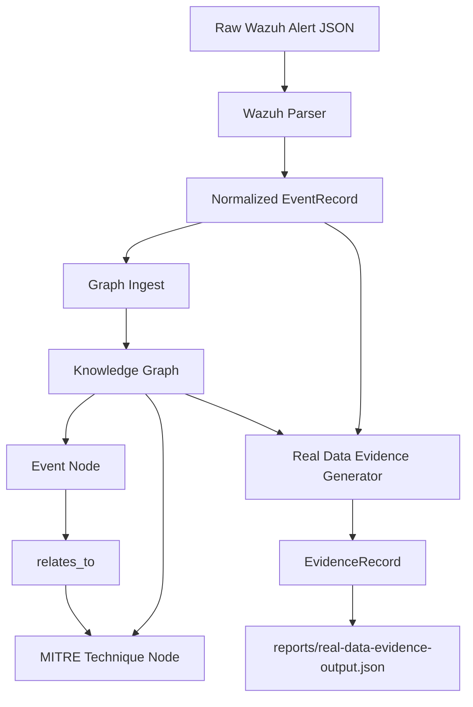

# Milestone 03: Real Data Pipeline

## Summary

The Real Data Integration milestone is complete for the first Wazuh-focused MVP.

Huginn/Muninn can now take normalized Wazuh alert data, add it to the Knowledge Graph, and generate Evidence Layer records from it.

This milestone proves the first real-data path:

```text
Wazuh alert
-> normalized EventRecord
-> Knowledge Graph Event + MITRE Technique nodes
-> EvidenceRecord
-> queryable defensive context
```

## Completed Components

### Wazuh Parser

Location:

```text
core/ingest/wazuh_parser.py
apps/api/tests/test_wazuh_parser.py
docs/REAL_DATA_PHASE1A_WAZUH_PARSER.md
```

Purpose:

Converts a raw Wazuh alert JSON dictionary into a normalized internal `EventRecord`.

Extracted fields:

- alert ID
- timestamp
- rule ID
- rule description
- agent name
- MITRE technique IDs from `rule.mitre.id`
- severity level

The parser handles missing fields safely by using `None` or empty lists.

### Graph Ingest

Location:

```text
core/ingest/graph_ingest.py
apps/api/tests/test_graph_ingest.py
docs/REAL_DATA_PHASE1B_GRAPH_INGEST.md
```

Purpose:

Adds normalized Wazuh `EventRecord` objects into the existing Knowledge Graph.

It creates:

- `Event` nodes
- `MITRE Technique` nodes
- `relates_to` relationships between events and MITRE techniques

It deduplicates:

- Event nodes by event ID
- MITRE Technique nodes by technique ID
- relationships by source and target

### Real Data Evidence Generation

Location:

```text
core/ingest/real_data_evidence.py
apps/api/tests/test_real_data_evidence.py
docs/REAL_DATA_PHASE1C_EVIDENCE.md
```

Purpose:

Generates Evidence Layer records from normalized Wazuh `EventRecord` objects.

Evidence records link:

- Wazuh event ID
- rule ID
- severity
- MITRE techniques
- related graph Event nodes
- related graph MITRE Technique nodes

Events without MITRE techniques are still preserved as evidence gaps.

## Sample Reports

### Graph Ingest Output

Location:

```text
reports/real-data-graph-ingest-output.json
```

Current sample summary:

```json
{
  "events_added": 3,
  "techniques_added": 2,
  "relationships_added": 3,
  "duplicates_skipped": 1,
  "events_without_mitre": 1
}
```

### Real Data Evidence Output

Location:

```text
reports/real-data-evidence-output.json
```

Current sample output includes:

- one high-confidence Wazuh evidence record with MITRE context
- one low-confidence evidence-gap record without MITRE context

## Validation

Focused tests passed:

```text
58 passed
```

Validated areas:

- Knowledge Graph
- Graph Intelligence
- Graph API
- Evidence Schema
- Evidence Builder
- Evidence Query Layer
- Evidence API
- Wazuh Parser
- Graph Ingest
- Real Data Evidence Generation

## How Real Wazuh Alerts Move Through The System



Step by step:

1. A raw Wazuh alert enters as a JSON dictionary.
2. The Wazuh Parser extracts important fields.
3. The parser returns a normalized `EventRecord`.
4. Graph Ingest adds the event to the Knowledge Graph.
5. MITRE technique IDs become MITRE Technique nodes.
6. The graph connects events to techniques with `relates_to`.
7. Real Data Evidence Generation creates evidence records from the normalized event and graph context.
8. Events without MITRE mappings become evidence gaps instead of being ignored.

## What This Unlocks

This milestone unlocks the first practical path from real SOC data into Huginn/Muninn's intelligence system.

It enables:

- real Wazuh alert normalization
- graph insertion from real alert data
- MITRE-linked event relationships
- evidence-backed records from real alerts
- evidence gap tracking when MITRE context is missing
- future file-based Wazuh ingestion
- future Suricata ingestion using the same pattern
- future real-data dashboard status panels

## Known Limitations

Current limitations:

- This phase parses Wazuh alert dictionaries, not full Wazuh alert files.
- There is no file watcher.
- There is no API endpoint for ingestion yet.
- The production Knowledge Graph file is not automatically updated.
- Evidence is generated from provided `EventRecord` objects, not a live SIEM feed.
- Suricata is not implemented yet.
- Duplicate handling is basic and based on event IDs, technique IDs, and relationship IDs.
- MITRE technique names are not enriched yet.
- Events without MITRE context are treated as evidence gaps, but no enrichment is attempted.
- No dashboard real-data ingestion status panel exists yet.
- No database or queue system is used.

## Next Recommended Phase

Recommended next phase:

```text
Real Data Phase 1D: Wazuh File Ingest
```

Why:

The system can parse one Wazuh alert dictionary, add normalized events to the graph, and generate evidence. The next smallest useful step is to read a Wazuh alert file containing multiple alerts.

Phase 1D should:

- read a local Wazuh JSON file
- parse each alert with the existing Wazuh Parser
- collect normalized `EventRecord` objects
- run Graph Ingest
- run Real Data Evidence Generation
- save a single ingestion summary report

Still do not add:

- API endpoints
- dashboard changes
- live Wazuh API calls
- databases
- queues
- automatic rule changes

## Explain Like I Am 10

Wazuh sends security alerts.

Phase 1A taught Huginn how to read one Wazuh alert and make a clean card from it.

Phase 1B taught Huginn how to put that card on the map.

Phase 1C taught Huginn how to make a proof card from it.

Now the system can say:

"I saw this Wazuh alert, it connects to this attack technique, and here is the proof."

If the alert does not say what attack technique it belongs to, Huginn still keeps it and says:

"I saw this alert, but I need more information."

## Explain Like I Am A SOC Analyst

This milestone adds the first real-data path into Huginn/Muninn.

The system can now normalize Wazuh alert dictionaries into internal event records, add those events to the Knowledge Graph, connect events to MITRE techniques, and generate evidence records.

Operational value:

- Wazuh alerts can become graph entities.
- MITRE mappings can become graph relationships.
- Parsed alerts can produce evidence records.
- Alerts without MITRE context are preserved as evidence gaps.
- The platform now has a foundation for real SOC telemetry ingestion.

This milestone does not yet ingest live Wazuh files or API streams. It creates the safe parser and transformation path first.

## Explain Like I Am A Hiring Manager

This milestone shows the platform moving from sample security intelligence toward real security data handling.

The implementation demonstrates:

- structured alert parsing
- defensive data normalization
- graph data modeling
- evidence generation
- confidence-aware handling of incomplete alerts
- test-driven implementation
- incremental system design

The important engineering decision is scope control. The system does not jump directly into live SIEM integration. It first proves the transformation pipeline from raw alert data to graph context and evidence-backed intelligence.

That is the correct foundation for a cybersecurity intelligence platform.
