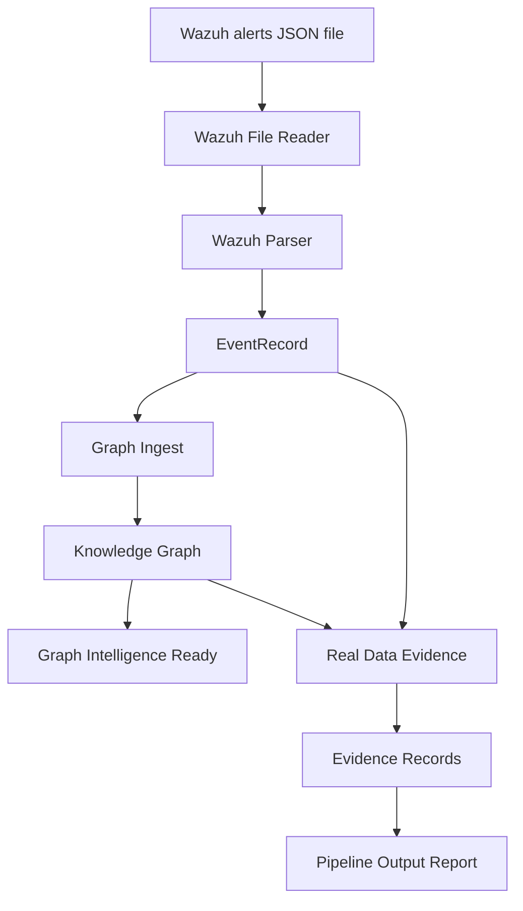

# Milestone 04: Wazuh File-to-Intelligence Pipeline

## Overview

Milestone 04 completes the first local real-data pipeline for Huginn/Muninn.

The platform can now read a Wazuh alert JSON file, normalize valid alerts, add them into the Knowledge Graph, and generate Evidence Layer records. This turns raw security alerts into structured intelligence artifacts that Huginn can reason over and Muninn can preserve as memory.

This milestone does not add live file watching, API ingestion, dashboard controls, databases, or automatic detection-rule changes. It is intentionally small and safe.

## Completed Components

### Wazuh File Reader

File:

```text
core/ingest/wazuh_file_reader.py
```

Purpose:

Reads a local Wazuh alert JSON file and returns normalized `EventRecord` objects.

Supported input:

- a single Wazuh alert object
- a list of Wazuh alert objects
- malformed records, which are skipped safely

Output:

- parsed event records
- records read
- records parsed
- records skipped
- source file path
- error details when a file cannot be read or parsed

### Wazuh Parser

File:

```text
core/ingest/wazuh_parser.py
```

Purpose:

Converts one raw Wazuh alert dictionary into a clean internal `EventRecord`.

Extracted fields:

- alert ID
- timestamp
- source system
- rule ID
- rule description
- host or agent name
- MITRE technique IDs
- severity

### Graph Ingest

File:

```text
core/ingest/graph_ingest.py
```

Purpose:

Takes normalized `EventRecord` objects and adds them to the Knowledge Graph.

Graph behavior:

- Wazuh alerts become `Event` nodes.
- MITRE technique IDs become `MITRE Technique` nodes.
- Events are connected to techniques with `relates_to` relationships.
- Duplicate events, techniques, and relationships are skipped safely.

### Real Data Evidence Generation

File:

```text
core/ingest/real_data_evidence.py
```

Purpose:

Creates Evidence Layer records from normalized Wazuh events.

Evidence records link:

- Wazuh event ID
- Wazuh rule ID
- severity
- MITRE techniques
- related graph entities when available

Events without MITRE mappings are treated as evidence gaps instead of being ignored.

### File-to-Intelligence Pipeline

File:

```text
core/ingest/wazuh_pipeline.py
```

Purpose:

Connects the Wazuh file reader, parser, graph ingest, and evidence generator into one small orchestration workflow.

Pipeline:

```text
Wazuh alert file
-> Wazuh File Reader
-> EventRecord list
-> Graph Ingest
-> Knowledge Graph
-> Real Data Evidence
-> Pipeline Output Report
```

## Pipeline Output Report

File:

```text
reports/real-data-pipeline-output.json
```

Current sample summary:

```json
{
  "records_read": 3,
  "records_parsed": 2,
  "records_skipped": 1,
  "events_added": 2,
  "techniques_added": 2,
  "relationships_added": 2,
  "duplicates_skipped": 0,
  "evidence_records_created": 2,
  "evidence_gaps_created": 1
}
```

The sample report includes:

- pipeline summary
- generated evidence records
- confidence scoring
- MITRE technique links
- evidence gap handling
- plain-English explanation

## Validation Status

Focused validation status:

```text
68 focused tests passing
```

Validated areas include:

- Knowledge Graph
- Graph Intelligence
- Graph API
- Evidence schema
- Evidence builder
- Evidence query layer
- Evidence API
- Wazuh parser
- Graph ingest
- Real data evidence generation
- Wazuh file reader
- Wazuh file-to-intelligence pipeline

## How A Wazuh File Moves Through Huginn/Muninn



Step by step:

1. A Wazuh JSON file is provided to the pipeline.
2. The file reader opens the file and separates valid records from malformed records.
3. The parser converts each valid Wazuh alert into a normalized `EventRecord`.
4. Graph ingest adds each event into the Knowledge Graph.
5. MITRE techniques from the Wazuh alert become graph nodes.
6. Event nodes are connected to MITRE technique nodes.
7. The evidence generator creates proof records from the normalized events.
8. Events without MITRE mappings become evidence gaps.
9. The pipeline writes a structured JSON output report.

## What This Unlocks

This milestone moves Huginn/Muninn from sample-only intelligence into local real-data processing.

It unlocks:

- real Wazuh alert file ingestion
- repeatable alert normalization
- graph-based representation of security events
- evidence generation from real alert data
- evidence gap identification
- safer future API ingestion
- safer future dashboard ingestion controls
- future file watching or scheduled ingestion

Most importantly, this creates a bridge between SOC telemetry and Huginn/Muninn's reasoning layers.

## Known Limitations

Current limitations:

- The pipeline reads local files only.
- There is no live file watcher yet.
- There is no Wazuh API integration yet.
- There are no new API endpoints for uploading alert files.
- The dashboard cannot trigger this pipeline yet.
- The pipeline does not persist ingested graph changes into the main graph report yet.
- Evidence generation is still MVP-level.
- Events without MITRE mappings are marked as gaps, but no enrichment is performed yet.
- The system does not modify Wazuh rules or generate production detections automatically.

## Next Recommended Phase

Recommended next phase:

```text
Real Data Integration Phase 3: Controlled Ingestion API
```

Why this phase makes sense:

- The file pipeline now works locally.
- The next useful step is exposing a safe read-only or controlled ingestion endpoint.
- This would allow the dashboard, scripts, or future automation to submit Wazuh alert files without changing detection rules.
- It keeps the architecture additive and avoids jumping too early into live watchers or autonomous investigation.

Expected scope:

- API endpoint for submitting a Wazuh alert file or JSON payload
- pipeline execution through the existing orchestration layer
- returned pipeline summary
- saved output report
- tests for valid, empty, malformed, and duplicate inputs

Out of scope for the next phase:

- live Wazuh API polling
- file watching
- dashboard redesign
- automatic detection tuning
- database persistence

## Explain Like I Am 10

Wazuh is like a security alarm system.

Before this milestone, Huginn could understand sample alarms.

Now Huginn can read an actual Wazuh alarm file.

It does four things:

1. Opens the Wazuh file.
2. Turns good alerts into clean event cards.
3. Puts those event cards on a map with MITRE attack labels.
4. Creates proof cards that explain what the alert means.

If one alert is broken, Huginn skips it and keeps working.

This means Huginn/Muninn can start learning from real security alerts instead of only sample data.

## Explain Like I Am A SOC Analyst

This milestone introduces a controlled path from Wazuh alert JSON into normalized defensive intelligence.

Raw Wazuh alerts are parsed into internal `EventRecord` objects, preserving rule context, host context, severity, timestamps, and MITRE mappings when present. Those records are then ingested into the Knowledge Graph as event nodes connected to MITRE technique nodes.

The Evidence Layer creates analyst-readable records for each event, including confidence scoring and evidence gap handling. Alerts without MITRE context are not discarded. They are flagged as gaps for future enrichment and tuning analysis.

Operationally, this provides a repeatable local workflow for converting SIEM telemetry into graph and evidence artifacts without modifying Wazuh rules or detection logic.

## Explain Like I Am A Hiring Manager

This milestone demonstrates practical security engineering beyond static lab documentation.

The platform now ingests real Wazuh-style alert files, normalizes them into a consistent internal model, maps security events to MITRE ATT&CK context, stores them as graph entities, and generates evidence records with confidence explanations.

The work shows:

- defensive data modeling
- SIEM alert normalization
- MITRE ATT&CK alignment
- graph-based security reasoning
- evidence-driven reporting
- safe handling of malformed input
- test-backed implementation
- incremental architecture design

The system remains early-stage, but it now has a working bridge from real SOC telemetry into the Huginn/Muninn intelligence pipeline.
