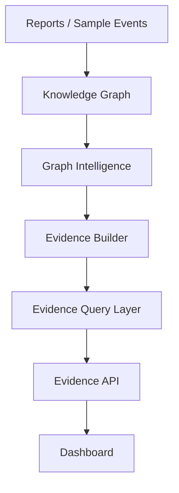
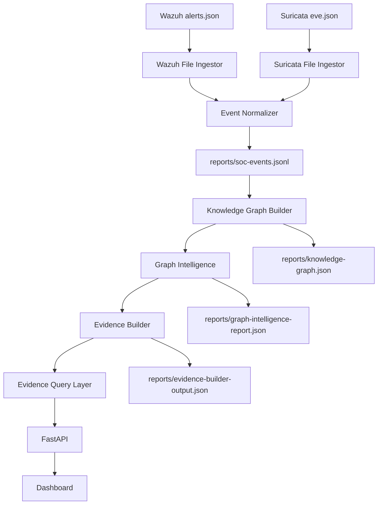

# Next Major Phase: Real Data Integration

## Goal

Design the smallest viable real-data integration phase for Huginn/Muninn.

The current platform already has:

- Knowledge Graph
- Graph Intelligence
- Evidence Layer
- API
- Dashboard

The next major phase should connect real security alerts into the existing intelligence pipeline without redesigning the platform.

## Current State

Huginn/Muninn currently works with structured JSON reports and generated sample data.

Current flow:



The system can already:

- model security context as graph nodes and relationships
- query graph relationships
- generate evidence records
- search evidence records
- expose graph and evidence data through FastAPI
- show graph and evidence panels in the dashboard

What is missing:

- real Wazuh alert ingestion
- real Suricata alert ingestion
- normalized real event records
- automatic graph refresh from real alerts
- automatic evidence generation from real alerts

## Recommended MVP

The smallest viable real-data implementation should be:

```text
File-based Wazuh + Suricata JSON ingestion
```

Do not start with streaming, agents, message queues, databases, or SIEM bidirectional control.

The first real-data MVP should:

1. Read Wazuh alert JSON files.
2. Read Suricata `eve.json` files.
3. Normalize alerts into the existing SOC event format.
4. Append normalized events to `reports/soc-events.jsonl`.
5. Rebuild the Knowledge Graph from normalized events.
6. Run Graph Intelligence.
7. Run Evidence Builder.
8. Expose results through existing API/dashboard surfaces.

## Architecture Diagram



## 1. How Wazuh Alerts Should Enter The System

Wazuh should enter through a read-only file ingestion module.

Initial input:

```text
Wazuh alerts.json
```

Recommended MVP source paths:

```text
data/input/wazuh/alerts.json
data/input/wazuh/*.json
```

The ingestor should:

- read alert JSON
- extract rule ID, rule description, severity, timestamp, agent name, source IP, destination IP, user, process, and MITRE fields when present
- map Wazuh rule levels to normalized severity
- preserve the original alert in `raw_payload`
- write normalized events to `reports/soc-events.jsonl`

Do not modify Wazuh rules.

Do not require live Wazuh API access for the MVP.

## 2. How Suricata Alerts Should Enter The System

Suricata should enter through a read-only file ingestion module.

Initial input:

```text
Suricata eve.json
```

Recommended MVP source paths:

```text
data/input/suricata/eve.json
data/input/suricata/*.json
```

The ingestor should:

- read `eve.json` line by line
- select records where `event_type` is `alert`
- extract signature, category, severity, timestamp, source IP, destination IP, source port, destination port, protocol, flow ID, and alert metadata
- map Suricata severity to normalized severity
- preserve the original alert in `raw_payload`
- write normalized events to `reports/soc-events.jsonl`

Do not modify Suricata rules.

Do not require live packet capture integration for the MVP.

## 3. How Events Should Be Normalized

All real alerts should become canonical SOC events.

Recommended normalized shape:

```json
{
  "event_id": "event:<uuid>",
  "source_system": "wazuh",
  "event_type": "detection.alert",
  "timestamp": "2026-06-08T00:00:00Z",
  "severity": "high",
  "title": "Repeated failed authentication",
  "description": "Wazuh detected repeated failed logon attempts.",
  "mitre_mapping": [
    {
      "technique_id": "T1110",
      "technique_name": "Brute Force",
      "tactic": "Credential Access"
    }
  ],
  "entities": {
    "source_ip": "10.0.0.5",
    "destination_ip": "10.0.0.10",
    "host": "windows-endpoint-01",
    "user": "lab.user",
    "process": "sshd"
  },
  "raw_payload": {},
  "normalized_context": {
    "sensor": "wazuh",
    "confidence": "source-alert",
    "lab_related": false
  }
}
```

Normalization rules:

- Keep the raw alert.
- Normalize only fields needed by graph/evidence workflows.
- Use a consistent `source_system`.
- Use MITRE mappings when provided.
- If MITRE is missing, keep the event and mark MITRE as unknown.
- Do not drop events just because they are incomplete.

## 4. How Events Should Become Graph Entities

Each normalized event should become a Knowledge Graph `Event` node.

If MITRE mapping exists:

- create or reuse a `MITRE Technique` node
- connect event to technique with `relates_to`

If the event appears in an attack sequence:

- connect event to an `Attack Chain` node

If the event matches known architecture weakness patterns:

- connect related technique or event to `Architecture Weakness`

Minimum graph relationships for MVP:

```text
Event relates_to MITRE Technique
Event previously_seen_as Memory Entry
Architecture Weakness weakens MITRE Technique
Defense Recommendation recommends Architecture Weakness
```

The graph should not need a database yet. JSON persistence is enough for the MVP.

## 5. How Evidence Records Should Be Generated Automatically

After normalized events update the graph, the existing Evidence Builder should run.

Automatic evidence generation should:

- create evidence from graph relationships
- include the original alert source path
- include the normalized event ID
- include related MITRE techniques
- include related weaknesses when available
- include related recommendations when available
- calculate confidence using the existing confidence model

Minimum automatic evidence rule:

```text
If an Event connects to a MITRE Technique and that technique connects to an Architecture Weakness, generate an evidence record.
```

Do not generate recommendations automatically yet.

Do not modify detection rules automatically.

## Required Modules

Smallest module set:

```text
core/real_data_ingestion.py
core/wazuh_ingestor.py
core/suricata_ingestor.py
core/event_normalizer.py
apps/api/tests/test_real_data_ingestion.py
docs/REAL_DATA_INTEGRATION.md
```

Optional sample data:

```text
data/input/wazuh/sample-alerts.json
data/input/suricata/sample-eve.json
```

Do not add a database in the MVP.

Do not add Kafka, Redis, RabbitMQ, or streaming workers in the MVP.

## Required APIs

Smallest API additions:

```text
POST /ingest/wazuh-file
POST /ingest/suricata-file
GET /ingest/status
```

Recommended behavior:

- API accepts a local file path or uses configured sample input path.
- API reads local JSON only.
- API returns counts of parsed, normalized, skipped, and written events.
- API does not accept arbitrary remote URLs.
- API does not modify Wazuh or Suricata.

Example response:

```json
{
  "source_system": "wazuh",
  "parsed": 20,
  "normalized": 18,
  "skipped": 2,
  "written": 18,
  "output_path": "reports/soc-events.jsonl",
  "explanation": "Wazuh alerts were normalized and added to the SOC event report."
}
```

## Dashboard Impact

Smallest dashboard update:

- Add a Real Data Status card.
- Show last ingestion source.
- Show parsed event count.
- Show normalized event count.
- Show skipped event count.
- Show latest source system.
- Link the user visually to Graph Intelligence and Evidence panels.

Do not add complex file upload yet.

Do not add live stream visualizations yet.

Do not add rule editing.

## Testing Strategy

### Unit Tests

Test:

- Wazuh alert parsing
- Suricata alert parsing
- severity normalization
- MITRE extraction
- raw payload preservation
- malformed alert handling
- write to `reports/soc-events.jsonl`

### Integration Tests

Test full local flow:

```text
sample Wazuh alert
-> normalize
-> write SOC event
-> rebuild Knowledge Graph
-> run Graph Intelligence
-> build Evidence
-> query Evidence
```

### API Tests

Test:

- `POST /ingest/wazuh-file`
- `POST /ingest/suricata-file`
- `GET /ingest/status`
- empty file handling
- malformed file handling

### Dashboard Tests

Minimum validation:

- API tests pass.
- Dashboard returns HTTP 200.
- Real Data Status card appears.
- Evidence panel still appears.
- Graph Intelligence panel still appears.

## Risks

### Overbuilding Too Early

Risk:

Adding streaming, databases, queue workers, or live SIEM APIs too soon could make the platform harder to understand and harder to test.

Mitigation:

Start with file ingestion only.

### Bad Alert Quality

Risk:

Real alerts may not include MITRE mappings or consistent fields.

Mitigation:

Preserve raw payloads and normalize best-effort fields.

### Duplicate Events

Risk:

Repeated ingestion could create duplicate events.

Mitigation:

Use deterministic event IDs when possible, based on source system, timestamp, rule/signature, and key entities.

### False Confidence

Risk:

The system may appear more certain than the data supports.

Mitigation:

Use confidence scoring and evidence gap language.

### Toolchain Instability

Risk:

The local Homebrew Node/npm environment has shown unreliable `next build` behavior.

Mitigation:

Keep API and core validation separate from web production build validation until Node/npm is repaired or replaced.

## Success Criteria

The MVP is successful when:

- Wazuh sample alerts are ingested from file.
- Suricata sample alerts are ingested from file.
- Normalized events are written to `reports/soc-events.jsonl`.
- Events become Knowledge Graph nodes.
- MITRE relationships are created when mappings exist.
- Graph Intelligence still works.
- Evidence records are generated from real-data graph relationships.
- Evidence API can retrieve records tied to real ingested events.
- Dashboard shows real-data ingestion status.
- No detection rules are modified.
- No database is required.

## What Not To Build Yet

Do not build these in the first real-data MVP:

- live Wazuh API integration
- live Suricata socket streaming
- Kafka, Redis, RabbitMQ, or queue workers
- graph database
- automatic detection rule generation
- automatic rule deployment
- file upload UI
- authentication
- autonomous investigation

## Explain Like I Am 10

Right now Huginn/Muninn has a map and proof cards.

But most of the clues are sample clues.

The next step is to let real security tools give Huginn/Muninn clues.

Wazuh and Suricata are like security cameras.

The MVP should take their alert files, clean them up, put them into the notebook, add them to the map, and make proof cards from them.

Start small. Read files first. Do not build a giant machine yet.

## Explain Like I Am A SOC Analyst

The next phase should connect real Wazuh and Suricata alert output into the existing SOC intelligence pipeline.

The recommended MVP is file-based ingestion from Wazuh `alerts.json` and Suricata `eve.json`.

The important part is normalization:

- preserve raw alert context
- extract consistent entities
- retain MITRE mappings when present
- append canonical SOC events to `reports/soc-events.jsonl`
- rebuild graph and evidence artifacts from those normalized events

This creates a traceable path from sensor alert to graph context to evidence-backed recommendation without changing detection rules.

## Explain Like I Am A Hiring Manager

The Real Data Integration phase moves Huginn/Muninn from generated intelligence artifacts toward operational security data.

The recommended implementation is intentionally conservative: file-based Wazuh and Suricata ingestion, normalized SOC events, graph updates, evidence generation, and dashboard visibility.

This shows engineering discipline because it avoids premature complexity while proving the most important platform capability:

```text
real alert -> normalized event -> graph context -> evidence-backed insight
```

That is the foundation needed before production integrations, streaming pipelines, or autonomous investigation workflows.
