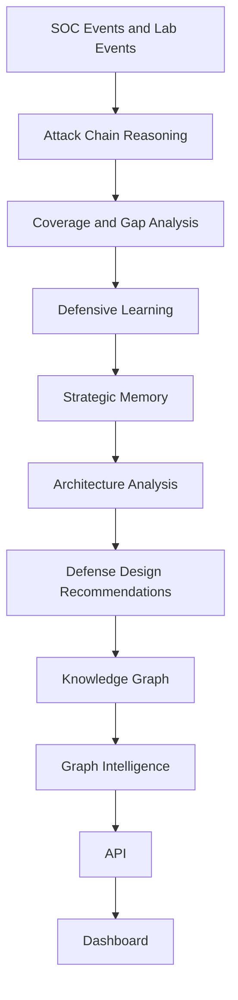
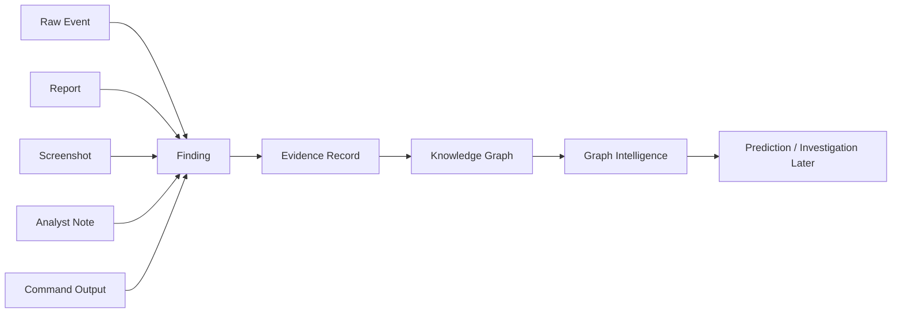

# Next Phase Recommendation

## Recommendation

The single highest-value next implementation phase is:

```text
Evidence Layer
```

Do not build the Prediction Engine next.

Do not build Autonomous Investigation next.

The platform first needs a reliable way to prove why Huginn believes something. The Evidence Layer should connect graph nodes, attack-chain findings, weaknesses, recommendations, reports, and dashboard views back to supporting artifacts.

Explain like I am 10 years old:

Huginn already has a map. Muninn already remembers clues. But before Huginn can guess what might happen next or investigate by itself, it needs a folder of proof. The Evidence Layer is that proof folder.

## Current Capabilities

Huginn/Munnin currently has a strong defensive intelligence foundation:

- Attack-chain reasoning
- MITRE technique mapping
- Coverage matrix reporting
- Gap prioritization
- Defensive decision planning
- Attack success probability modeling
- Defensive learning
- Strategic memory
- Attack surface modeling
- Security architecture analysis
- Defense design recommendations
- JSON-backed Knowledge Graph
- Graph Intelligence query functions
- Read-only Graph Intelligence API
- Dashboard Graph Intelligence panel

Current flow:



Current graph intelligence capabilities:

- Find related entities
- Find connected architecture weaknesses
- Find recommendations for a MITRE technique
- Find similar incidents

Current validation state:

- Knowledge Graph exists
- Graph Intelligence exists
- Graph API exists
- Dashboard panel exists
- Focused graph/API tests have passed
- Local API startup has been validated after rebuilding the API virtual environment

## Current Weaknesses

The current platform can explain connections, but it does not yet fully prove them.

Main weaknesses:

- Findings are connected to reports, but not always to clear evidence records.
- Screenshots, logs, report snippets, event IDs, commands, timelines, and analyst notes are not normalized into one evidence model.
- The dashboard can show graph intelligence, but not the proof behind each finding.
- The API can answer graph questions, but does not expose evidence for the answer.
- Prediction would be weak without trustworthy historical evidence.
- Autonomous investigation would be risky without source-backed reasoning.

Explain like I am 10 years old:

Right now Huginn can say, "These things are connected." The next step is letting Huginn say, "Here is the proof."

## Missing Intelligence Components

The biggest missing intelligence component is an evidence-backed reasoning layer.

Missing pieces:

- Evidence records
- Evidence-to-graph links
- Evidence confidence scoring
- Source artifact references
- Timeline support
- Analyst note support
- Finding justification
- Evidence summaries for the API
- Evidence visibility in the dashboard

These pieces matter because future intelligence features need trustworthy inputs.



## Why The Evidence Layer Matters

The Evidence Layer matters because it makes Huginn/Munnin more trustworthy.

Without evidence, the system can produce useful-looking intelligence but cannot always show why the intelligence is valid.

With evidence, the system can answer:

- What event supports this finding?
- What report created this weakness?
- What MITRE technique was observed?
- What command, alert, or timeline entry proves the claim?
- How confident is this conclusion?
- Has this same evidence pattern appeared before?

For security work, this is critical. A SOC analyst, security engineer, or hiring manager will trust the platform more if every conclusion can point back to proof.

## What This Phase Unlocks

The Evidence Layer unlocks:

- Better incident timelines
- Stronger report credibility
- More useful dashboard drill-downs
- Better interview and portfolio proof
- More reliable prediction later
- Safer autonomous investigation later
- Confidence scoring
- Finding justification
- Evidence-backed executive summaries

Most importantly, it turns the platform from:

```text
connected intelligence
```

into:

```text
defensible intelligence
```

## What Is Required Before A Prediction Engine

A Prediction Engine should not be the next phase yet.

Prediction requires:

- Historical patterns
- Known outcomes
- Attack-chain progression history
- Evidence of what actually happened
- Evidence of what was missed
- Confidence scoring
- Repeatable feature inputs
- A way to compare similar situations

The platform has some historical patterns and graph context, but the evidence model is not strong enough yet.

If Prediction is built too early, it may produce guesses that look impressive but are hard to defend.

The Evidence Layer should come first so predictions can later say:

```text
I predict this because these past events, techniques, outcomes, and evidence records match this current situation.
```

## What Is Required Before Autonomous Investigation

Autonomous Investigation should also wait.

Autonomous Investigation requires:

- Evidence collection
- Evidence ranking
- Timeline building
- Similar incident lookup
- Analyst-safe explanations
- Confidence boundaries
- Clear source references
- Guardrails to avoid unsupported conclusions

The platform already has graph lookup and similar incident search, but it does not yet have a formal evidence package for each investigation.

If Autonomous Investigation is built too early, it may summarize findings without enough proof.

The Evidence Layer should come first so autonomous investigation can later produce:

```text
Finding -> Supporting Evidence -> Timeline -> Confidence -> Recommended Next Step
```

## Recommended Phase Scope

Recommended phase name:

```text
Phase: Evidence Layer
```

Primary objective:

Create a structured evidence model that links SOC events, attack-chain findings, graph nodes, reports, screenshots, command outputs, and analyst notes.

This should remain read-only and recommendation-focused. It should not modify detection rules, lab configs, or dashboard architecture beyond a small visibility panel.

## Expected Files And Modules

Expected new core modules:

```text
core/evidence_schema.py
core/evidence_store.py
core/evidence_linker.py
core/evidence_context_builder.py
```

Expected reports/artifacts:

```text
reports/evidence-index.json
reports/evidence-timeline.json
reports/evidence-summary.json
```

Expected pattern/memory artifacts:

```text
core/patterns/evidence-patterns.json
core/patterns/evidence-confidence-summary.json
```

Expected tests:

```text
apps/api/tests/test_evidence_api.py
tests or app-level tests for evidence schema/linking if the repo pattern supports them
```

Expected documentation:

```text
docs/EVIDENCE_LAYER_EXPLAINED.md
docs/DEPLOYMENT_AND_TESTING_PLAN.md
```

## Expected Evidence Model

Smallest useful evidence record:

```json
{
  "evidence_id": "evidence:example",
  "source_type": "soc_event",
  "source_path": "reports/soc-events.jsonl",
  "source_reference": "event:f26fa03a-6c8e-44ca-b906-12c974dcbcbf",
  "related_graph_entities": ["mitre:T1078"],
  "summary": "Valid account activity appeared during the simulated attack chain.",
  "confidence": "medium",
  "timestamp": "2026-06-01T18:43:55Z"
}
```

Evidence source types should include:

- SOC event
- Lab event
- Detection alert
- Report
- Architecture weakness
- Defense recommendation
- Screenshot reference
- Command output
- Analyst note

## Expected API Changes

Smallest read-only API endpoints:

```text
GET /evidence/summary
GET /evidence/entity/{entity_id}
GET /evidence/timeline
GET /evidence/finding/{finding_id}
```

Possible response shape:

```json
{
  "entity_searched": "mitre:T1078",
  "evidence": [
    {
      "evidence_id": "evidence:valid-account-001",
      "source_type": "soc_event",
      "summary": "Valid account activity appeared in the attack chain.",
      "confidence": "medium"
    }
  ],
  "explanation": "This evidence supports why the entity matters."
}
```

API rules:

- Read-only
- JSON-backed
- No database yet
- No authentication yet unless the project chooses to add it later
- No automatic detection changes

## Expected Dashboard Changes

Smallest dashboard addition:

```text
Evidence Intelligence Panel
```

It should show:

- Evidence count
- Evidence by source type
- Evidence linked to selected MITRE technique
- Evidence linked to selected architecture weakness
- Recent evidence timeline
- Confidence summary

Dashboard behavior should remain simple:

- No major redesign
- No complex graph visualization yet
- No investigation automation yet
- No prediction UI yet

The dashboard should answer:

```text
Why does Huginn believe this?
```

## Deployment Impact

Deployment impact should be low.

Expected impact:

- No new database
- No new external services
- No new detection-engine dependencies
- No changes to lab configs
- No changes to detection rules
- JSON files remain the persistence layer
- API gains read-only evidence endpoints
- Dashboard gains a small evidence panel

Operational impact:

- Local sample-data mode remains supported
- Home lab mode can add evidence references later
- Dashboard/API mode gains more explainability

Risk level:

```text
Low to medium
```

Reason:

The phase adds a new intelligence layer but should not alter existing detection, graph, or dashboard behavior.

## Why Not Prediction Engine Next

Prediction is attractive, but it is not the best immediate next step.

Prediction without evidence can become unsupported guessing.

The platform should first collect and structure proof so future predictions can explain themselves.

Build Evidence Layer first. Then build Prediction Engine on top of evidence-backed graph patterns.

## Why Not Autonomous Investigation Next

Autonomous Investigation is also attractive, but it requires strong evidence handling.

An autonomous investigation system must know:

- What evidence exists
- Which evidence matters
- What the timeline is
- What confidence level is reasonable
- What facts are missing

The current platform has graph connections but not a formal evidence model.

Build Evidence Layer first. Then autonomous investigation can use evidence safely.

## Final Decision

Recommended next phase:

```text
Evidence Layer
```

Primary reason:

It is the highest-leverage foundation for both future Prediction Engine and Autonomous Investigation.

What it unlocks:

- Defensible graph intelligence
- Better SOC reporting
- Stronger dashboard proof
- Safer prediction
- Safer autonomous investigation
- Better portfolio/interview credibility

## Explain Like I Am 10

Huginn has a brain.

Muninn has a memory.

The Knowledge Graph is their map.

Graph Intelligence lets them ask questions about the map.

But now they need a proof box.

The Evidence Layer is the proof box. It stores the clues that show why something is true.

Before Huginn guesses the future or investigates by itself, it should be able to say:

```text
I know this because here are the clues.
```

That is why the Evidence Layer should come next.

## Implementation Summary

Recommended implementation phase:

```text
Phase 3: Evidence Layer MVP
```

Expected build size:

```text
Small to medium
```

Expected first milestone:

```text
Create JSON-backed evidence records and link them to Knowledge Graph entities.
```

Expected success criteria:

- Evidence records exist in JSON
- Evidence links to graph entities
- API can return evidence for a MITRE technique or event
- Dashboard can show evidence summary
- Tests validate evidence lookup
- No detection rules are modified
- No lab configs are modified
- No database is added

## Recommended First Task

Start with:

```text
Implement Evidence Layer MVP
```

Do not start with prediction.

Do not start with autonomous investigation.

Build proof first.
