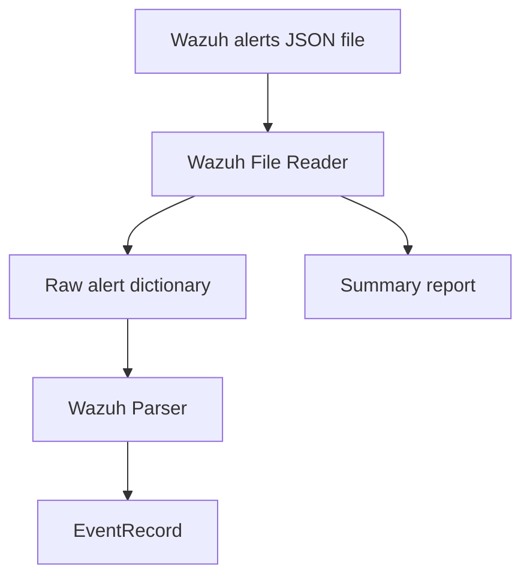

# Real Data Phase 2A: Live Wazuh Alert File Reader

## Goal

Allow Huginn to read Wazuh alert JSON files and turn valid alert records into normalized `EventRecord` objects.

This phase only reads files. It does not update the graph, evidence layer, API, or dashboard.

## What Was Added

```text
core/ingest/wazuh_file_reader.py
apps/api/tests/test_wazuh_file_reader.py
docs/REAL_DATA_PHASE2A_FILE_READER.md
```

## Input

The file reader accepts a local JSON file path.

It supports:

- one Wazuh alert object
- a list of Wazuh alert objects

## Output

The reader returns:

```python
WazuhFileReadResult(
    events=[EventRecord(...)],
    summary={
        "records_read": 1,
        "records_parsed": 1,
        "records_skipped": 0,
        "source_path": "path/to/alerts.json"
    }
)
```

## Safe Skipping

Malformed records are skipped safely.

Examples of malformed records:

- strings
- numbers
- broken JSON files
- missing files

The reader counts skipped records instead of crashing.

## How It Works



## What This Phase Does Not Do

This phase does not:

- modify Graph Ingest
- modify the Evidence Layer
- add API endpoints
- modify the dashboard
- read live Wazuh APIs
- tail files continuously
- modify Wazuh rules

## Explain Like I Am 10

Wazuh can save alerts in a file.

This reader opens the file and looks at each alert.

If the alert is good, it turns it into a clean event card.

If something in the file is broken, it skips that part and keeps going.

At the end it says:

- how many records it read
- how many became clean event cards
- how many were skipped

## Why This Matters

Phase 1A parsed one Wazuh alert dictionary.

Phase 2A reads alert files, which is closer to real Wazuh usage.

This prepares Huginn/Munnin for the next step:

```text
Wazuh alert file
-> EventRecord list
-> Graph Ingest
-> Real Data Evidence
```
