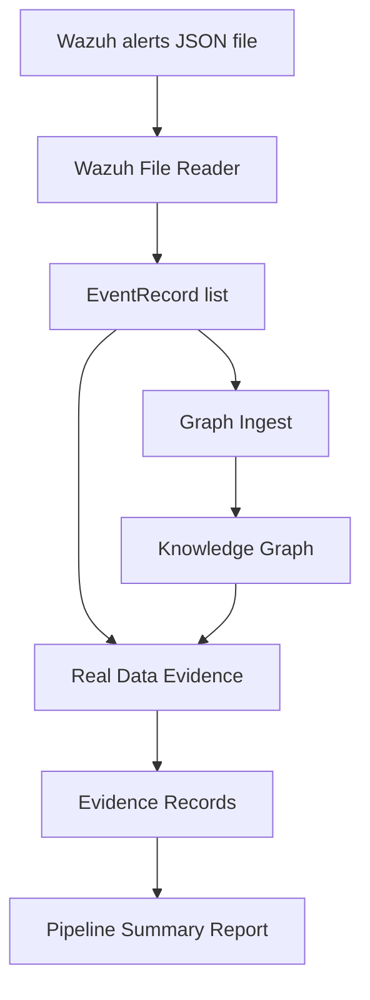

# Real Data Phase 2B: File-to-Intelligence Pipeline

## Goal

Create one small orchestration layer that reads a Wazuh alert file, parses alerts, ingests events into the Knowledge Graph, and generates Evidence Layer records.

This phase connects existing pieces. It does not introduce new API endpoints, dashboard changes, file watching, databases, or new evidence logic.

## What Was Added

```text
core/ingest/wazuh_pipeline.py
apps/api/tests/test_wazuh_pipeline.py
reports/real-data-pipeline-output.json
docs/REAL_DATA_PHASE2B_PIPELINE.md
```

## Pipeline Flow



## Summary Output

The pipeline returns:

```json
{
  "records_read": 3,
  "records_parsed": 2,
  "records_skipped": 1,
  "events_added": 2,
  "techniques_added": 2,
  "relationships_added": 2,
  "duplicates_skipped": 0,
  "evidence_records_created": 2,
  "evidence_gaps_created": 1
}
```

## Sample Report

Sample output is saved to:

```text
reports/real-data-pipeline-output.json
```

The sample report includes:

- pipeline summary
- generated evidence records
- plain-English explanation
- source file path

## Graceful Failure Handling

Malformed files and empty inputs are handled safely.

Invalid JSON produces:

- zero records read
- zero records parsed
- one skipped record
- zero graph additions
- zero evidence records
- an error field in the output

An empty list produces a valid summary with all counts set to zero.

## What This Phase Does Not Do

This phase does not:

- add API endpoints
- modify dashboard code
- modify the parser
- modify graph ingest
- modify evidence generation
- watch files continuously
- call the live Wazuh API
- write to a database
- modify Wazuh rules

## Explain Like I Am 10

Before this phase, Huginn had separate tools:

- one tool reads Wazuh files
- one tool puts alerts on the map
- one tool makes proof cards

Phase 2B connects those tools into one small pipeline.

Now Huginn can say:

"Read this Wazuh file, make clean event cards, put them on the map, and make proof cards."

If the file is broken, Huginn does not crash. It says what went wrong and reports zero useful records.

## Why This Matters

This is the first complete local file-to-intelligence workflow:

```text
Wazuh file
-> EventRecord
-> Knowledge Graph
-> EvidenceRecord
-> summary report
```

It is the smallest useful real-data pipeline before adding APIs, dashboard controls, or live file watching.
