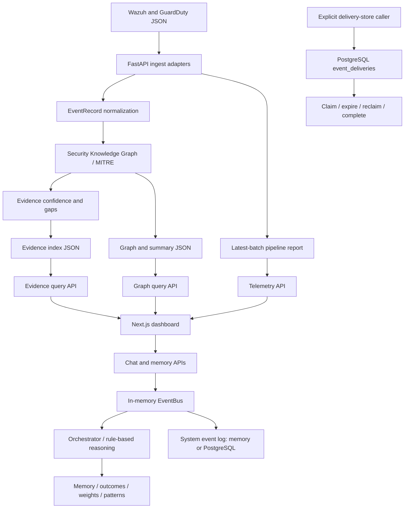

# Architecture

This describes the implementation through Phase 3B.2 (`9371666`), not a production deployment or an autonomous security system. See the [README](../README.md) for setup and the [persistence guide](MUNINN_PERSISTENCE.md) for storage contracts and validation.

## Three Separate Data Paths

| Path | Entry point | Processing | Persistence |
| --- | --- | --- | --- |
| Security telemetry | `POST /ingest/wazuh`, `POST /ingest/guardduty` | Normalize alerts, build graph relationships and evidence | Local JSON, independent of `PERSISTENCE_BACKEND` |
| Reasoning workflow | `/chat`, `/memory` | In-memory EventBus and subscribed orchestrator handlers | Memory by default; four store interfaces backed by five PostgreSQL tables when enabled |
| Durable-delivery foundation | Explicit Python store calls and tests only | Admission, claim, retrieval, ownership-checked completion | Separate PostgreSQL `event_deliveries` table; no dispatcher |

There is deliberately no arrow from delivery storage to the orchestrator: automatic durable dispatch is not implemented. Security `EventRecord`, workflow `Event`, and durable `DeliveryEnvelope` are distinct models, not interchangeable queue records.

## Security Telemetry and Evidence

The [Wazuh](../apps/api/src/huginn_muninn_api/core/wazuh_ingest_api.py) and [GuardDuty](../apps/api/src/huginn_muninn_api/core/guardduty_ingest_api.py) adapters accept JSON payloads, not live sensor connections. Parsers under [core/ingest](../core/ingest) normalize them into `EventRecord` objects.

Graph ingestion creates event nodes, MITRE technique nodes, and deterministic relationships. The [Security Knowledge Graph](../core/knowledge_graph.py) supports traversals for related entities, weaknesses, recommendations, and similar incidents. Rule-based evidence logic assigns confidence factors and records missing context; these are not calibrated probabilities or proof of a security incident. Runtime ingestion identifies missing MITRE relationships as evidence gaps.

The adapters load existing graph/evidence files and merge by stable IDs. One process-safe file lock covers the shared read-modify-write sequence for:

- `reports/knowledge-graph.json`
- `core/patterns/knowledge-graph-summary.json`
- `reports/evidence-index.json`

[JSON persistence](../core/json_persistence.py) uses same-directory temporary files, file fsync, atomic replacement, and directory fsync on supported macOS/Linux local filesystems. Each file is atomic; the three files are **not a single transaction**. Readers may observe different generations across files after a partial failure. A failed request may have persisted some changes, so callers should retain stable alert IDs for resubmission. This is caller-driven recovery, not automatic replay.

`reports/real-data-pipeline-output.json` is written after protected persistence, outside that lock, using a direct write. It represents the latest ingestion batch and does not have the same atomic-write protection. Concurrent batches can overwrite that report; do not treat it as a complete event history.

The evidence query merges available evidence sources and prefers the persisted index over stale generated records sharing an evidence ID. Graph totals, merged evidence counts, and latest-batch telemetry counts therefore have different scopes. Historical sample timestamps are not live security activity.

## FastAPI and Browser Integration

[main.py](../apps/api/src/huginn_muninn_api/main.py) exposes ingestion, graph, evidence, telemetry, reasoning, and health routes. [The dashboard](../apps/web/app/page.tsx) uses browser fetch requests and polling; `NEXT_PUBLIC_API_URL` defaults to `http://localhost:8000` and is embedded during a production build. Development CORS allows localhost and loopback port 3000; it is not authentication.

The dashboard includes telemetry, evidence, graph exploration, conversation, decisions, reasoning patterns, learning outcomes, and keyword-based security analysis. Voice and live SOC sensor integration remain planned/scaffolded. There is no external LLM call or implemented vector-search backend in the current runtime.

Repository-root `core` and API `src/core` share a Python package name. The three cooperating evidence/ingestion loaders use a [shared process-wide RLock](../apps/api/src/huginn_muninn_api/core/repository_module_lock.py) across snapshot, temporary import, initialization, and restoration of `core` module entries. Evidence queries and artifact persistence remain outside this lock. It protects these cooperating loaders, not arbitrary imports elsewhere in the process.

## EventBus and Reasoning

The [EventBus](../apps/api/src/core/event_bus.py) uses an `asyncio.Queue` with one worker. It distinguishes `not_started`, `running`, `closing`, `stopped`, and `failed`. Submission requires a healthy worker; API admission failures return HTTP 503. Successful `/chat` responses still report acceptance, not completed processing or durable admission.

For each dequeued event, the worker writes the system log before dispatching subscribed handlers. A storage failure prevents dispatch. A handler failure stops the remaining dispatch for that event; completed handlers are not replayed. Contained failures are counted and subsequent events remain processable. Unexpected worker termination marks failure; there is no automatic restart or retry. Queue accounting distinguishes successful, failed, timed-out, cancelled, and abandoned work.

Development defaults are five seconds for processing, five seconds for queue drain, one second for cancellation wait, and five seconds for database pool closure. They are configurable through `EVENT_PROCESSING_TIMEOUT_SECONDS`, `EVENT_DRAIN_TIMEOUT_SECONDS`, `EVENT_CANCELLATION_TIMEOUT_SECONDS`, and `DATABASE_POOL_CLOSE_TIMEOUT_SECONDS`. These are cooperative asyncio budgets, not guarantees against blocking synchronous code or cancellation-resistant handlers. Shutdown rejects submissions, attempts a bounded drain, accounts for abandoned work, and independently attempts pool cleanup.

`GET /health` reports worker availability and counters; `database_readiness` remains `not_checked`. A surviving worker does not prove PostgreSQL is reachable. Even with PostgreSQL system-event logging, the queue is **best-effort and in-memory**: acceptance can precede storage, and stored logs are not a replay queue.

The separate [intelligence graph](../apps/api/src/core/intelligence_graph.py) routes reasoning between planning, memory lookup, and tool-use branches. It is not the security graph. Decisions use rule-based scoring, outcome-aware memory ranking, learned weights, and reasoning-pattern influence. Current tool/response behavior is limited, not autonomous external execution.

Four store interfaces cover memories, system logs, outcomes/weights, and patterns. Application startup selects in-memory or PostgreSQL stores and hydrates reasoning state. Learned weights are authoritative in their outcome store, not reconstructed from redundant memory records. A [trace reader](../apps/api/src/core/trace_reader.py) reconstructs correlated stored events, outcomes, and memories in Python; there is no exposed `/trace/{id}` route.

## Durable Admission and Lease Ownership

[DeliveryEnvelope](../apps/api/src/core/event_delivery.py) and [PostgresDeliveryStore](../apps/api/src/core/stores/event_delivery_store.py) form an opt-in storage API. No production route constructs this store. Setting `PERSISTENCE_BACKEND=postgres` selects reasoning stores and applies schema; it does not activate a durable dispatcher.

Admission validates a recoverable envelope and payload, enforces scoped idempotency in PostgreSQL, and returns only after transaction commit. Claims use `FOR UPDATE SKIP LOCKED`, database time, worker IDs, unique lease tokens, and incremented attempts. Claim transactions end before caller processing. Completion checks active ownership under a row lock and clears ownership on success.

An expired processing record can be explicitly claimed again with a new token. Tests and a temporary crash diagnostic demonstrated recovery after process termination. Recovery requires a caller: there is no scheduler or startup scan executing recovered events automatically.

Tokens fence completion in the database; they cannot stop an expired worker from performing external actions. This supports a future at-least-once design, but there is no end-to-end delivery guarantee, exactly-once external execution, or complete side-effect deduplication today.

## Security Boundaries and Next Work

The project is for local defensive investigation and synthetic validation. Authentication and authorization are absent. Compose publishes database/service ports with development defaults; ingestion can expose raw exception details. Use loopback-only services, disposable test resources, and no real sensitive telemetry in public demonstrations. Production deployment is not approved.

Future work, not implemented: durable dispatcher/handler integration, lease renewal, bounded retry and dead-letter execution, side-effect idempotency, access controls, deployment hardening, and real sensor integrations. None of these capabilities should be inferred from the presence of a durable storage table.
