# SOC Event Flow

This document defines the integration pipeline between SOC detection content and the Huginn/Muninn intelligence layer.

## Pipeline

```mermaid
flowchart LR
  Lab["LAB<br/>attack simulation"] --> Detection["DETECTION<br/>Wazuh, Suricata, Sysmon, auditd"]
  Detection --> EventBus["EVENT BUS<br/>canonical SOC event"]
  EventBus --> Mapping["ROUTING<br/>detection-to-playbook map"]
  Mapping --> Playbook["PLAYBOOK<br/>triage and response"]
  Playbook --> Report["REPORT<br/>incident outcome"]
  Report --> Chain["ATTACK CHAIN<br/>technique sequence and transitions"]
  Chain --> Matrix["COVERAGE MATRIX<br/>detected, correlated, response effectiveness"]
  Matrix --> Priority["GAP PRIORITY<br/>severity, exploitability, exposure"]
  Priority --> Success["ATTACK SUCCESS MODEL<br/>probability and risk score"]
  Success --> Defense["DEFENSE DECISION<br/>action plan"]
  Defense --> Learning["DEFENSE LEARNING<br/>recurring weaknesses"]
  Learning --> Evolution["EVOLUTION TRACKING<br/>coverage, risk, gap closure"]
  Evolution --> Strategic["STRATEGIC MEMORY<br/>long-term patterns"]
  Strategic --> Architecture["ARCHITECTURE ANALYSIS<br/>structural blind spots"]
  Architecture --> Surface["ATTACK SURFACE MODEL<br/>pre-auth, auth, post-auth"]
  Surface --> Design["DEFENSE DESIGN<br/>subsystems and telemetry architecture"]
  Design --> Complexity["COMPLEXITY ANALYSIS<br/>simplification opportunities"]
  Report --> Metrics["METRICS<br/>coverage, false positives, response time"]
  Metrics --> Gaps["GAP ANALYSIS<br/>missed patterns and weak coverage"]
  Strategic --> Memory["MEMORY FEEDBACK<br/>patterns and suggestions"]
  Complexity --> Memory["MEMORY FEEDBACK<br/>patterns and suggestions"]
  Defense --> Memory["MEMORY FEEDBACK<br/>patterns and suggestions"]
  Priority --> Memory["MEMORY FEEDBACK<br/>patterns and suggestions"]
  Gaps --> Memory["MEMORY FEEDBACK<br/>patterns and suggestions"]
  Memory --> Context["CONTEXT BUILDER<br/>future reasoning input"]
  Context --> EventBus
```



## Canonical Event Format

All SOC events use the same normalized shape:

```json
{
  "event_id": "uuid",
  "event_type": "detection.alert",
  "source_system": "wazuh",
  "mitre_mapping": [
    {
      "tactic": "Credential Access",
      "technique_id": "T1110",
      "technique_name": "Brute Force"
    }
  ],
  "severity": "high",
  "timestamp": "2026-06-01T00:00:00+00:00",
  "raw_payload": {},
  "normalized_context": {
    "detection_name": "SOC-WIN-AUTH-BRUTEFORCE-001",
    "source_ip": "10.0.0.10",
    "target_account": "lab.user"
  }
}
```

## Component Responsibilities

### labs

Labs generate controlled attack activity and document expected telemetry. They do not perform routing or response decisions.

### detection-engine

Detection content remains sensor-focused. Wazuh, Suricata, Sysmon, and auditd artifacts produce or describe alerts but do not select playbooks or update themselves.

### core

The core layer normalizes events, routes detections to playbooks, records outcomes, and builds intelligence context for Huginn/Muninn reasoning.

Primary modules:

- `core/event_schema.py`: canonical SOC event model
- `core/event_bus.py`: in-memory routing and event persistence
- `core/detection_response_map.py`: detection-to-playbook mapping
- `core/feedback_loop.py`: outcome and suggestion logging
- `core/metrics_engine.py`: SOC health metrics from event bus history and outcome memory
- `core/gap_analysis.py`: structured gap findings for missed or weak coverage areas
- `core/attack_chain_analyzer.py`: MITRE chain reconstruction and missing transition analysis
- `core/coverage_matrix.py`: technique-level detection, correlation, and response coverage
- `core/gap_prioritizer.py`: ranked detection gap backlog
- `core/attack_success_model.py`: attack-chain success probability estimates
- `core/defense_prioritizer.py`: defensive improvement ranking
- `core/defense_decision_engine.py`: structured action plan for analyst approval
- `core/defense_learning_engine.py`: recurring weakness and structural failure insights
- `core/defense_evolution_tracker.py`: defensive improvement trend tracking
- `core/strategic_memory.py`: long-term defensive intelligence memory
- `core/security_architecture_analyzer.py`: architecture-level weakness analysis
- `core/attack_surface_model.py`: pre-auth, auth, and post-auth exposure model
- `core/defense_design_generator.py`: system design recommendation generation
- `core/defense_complexity_engine.py`: coverage versus complexity analysis
- `core/context_builder.py`: aggregated reasoning context
- `core/patterns/`: logged-only memory feedback

### playbooks

Playbooks define analyst response procedures. They receive routed context from the event bus and produce response decisions for reports.

### reports and evidence

Reports store final outcomes. Evidence stores sanitized supporting artifacts. Together they act as Muninn-style memory inputs for recurrence and pattern review.

## Feedback Policy

Feedback is logged only. The system may suggest rule tuning based on incident outcomes, but it does not modify detection rules automatically.

Manual analyst review is required before any tuning suggestion becomes a detection rule change.

Metrics and gap analysis consume canonical event history through `SocEventBus`. They do not read Wazuh, Suricata, Sysmon, auditd, or lab configuration files directly.
